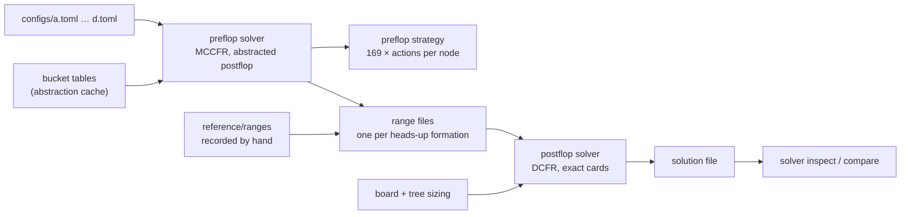
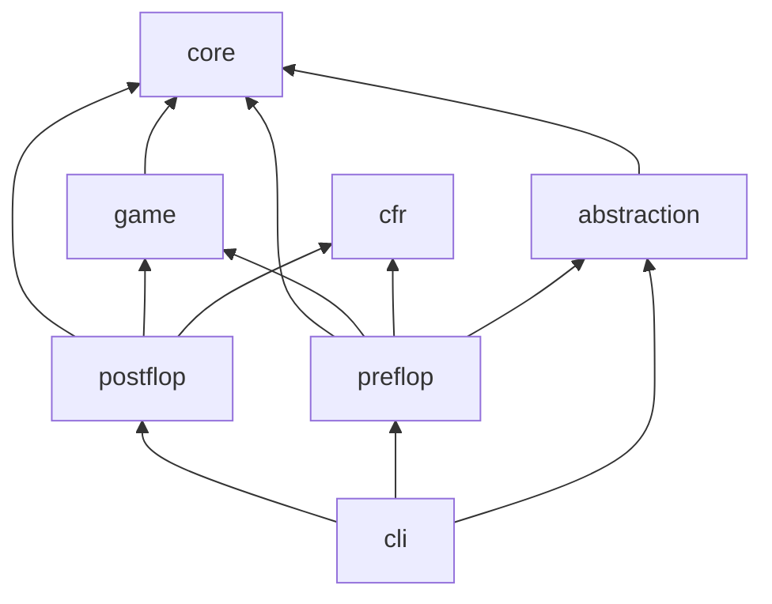

# Architecture

Design written before any code. The requirements are in [BRIEF.md](../BRIEF.md). Choices made while planning, and the questions still open, are in [DECISIONS.md](DECISIONS.md). The order of work is in [ROADMAP.md](ROADMAP.md).

## Overview

Two solvers share one library and are joined by range files. The preflop solver writes one range file per heads-up formation. The postflop solver reads a range file plus a board. Range files recorded by hand from a reference source use the same format, so the postflop solver can be used before the preflop solver exists.



## Crate graph

Arrows point from a crate to the crates it depends on.



| Folder | Package | Holds |
| --- | --- | --- |
| `crates/core` | `pk-core` | cards, card sets, combos, 169 classes, ranges, evaluator, equity, suit isomorphism, hand indexer |
| `crates/game` | `pk-game` | `GameConfig`, positions and action order, betting-tree builders, range-file format |
| `crates/cfr` | `pk-cfr` | regret matching, discount schedules, toy-game CFR and MCCFR, best response, vector-form helpers |
| `crates/abstraction` | `pk-abstraction` | equity histograms, k-means, bucket tables |
| `crates/postflop` | `pk-postflop` | heads-up flop-to-river solver, solution files |
| `crates/preflop` | `pk-preflop` | N-player MCCFR over the abstracted game, checkpoints, range export |
| `crates/cli` | `pk-cli` (binary `solver`) | every command |

Packages are prefixed `pk-` because a crate named `core` collides with Rust's built-in `core` crate.

Rules:

- **`cfr` knows nothing about poker.** It works on slices and on a small game trait. Kuhn and Leduc test the same regret code that both solvers use.
- **Library crates never print.** They return results and report progress through a callback. Only `cli` writes to the terminal.
- **Few dependencies, all permissively licensed:** `rayon`, `serde` + `toml` + `serde_json`, `rand` + `rand_chacha`, `zstd`, `memmap2`, `thiserror` in libraries and `anyhow` + `clap` in `cli`, with `criterion` and `proptest` for development only. No AGPL dependency, and no AGPL code copied (brief, Validation).

## Conventions

- **Chips are integers.** Every amount is a `u32` count of chips, with 1 bb = 100 chips. Bet sizes are computed in `f64` and rounded to whole chips by one function, and a tree never holds two actions with the same rounded amount. The config loader rejects amounts that are not whole chips.
- **Cards.** `Card(u8)` is `4 × rank + suit`, with rank 0 the deuce and rank 12 the ace. `CardSet(u64)` is a bitmask. The 1,326 combos have a fixed index order. The 169 hand classes use the 13×13 grid order: pairs on the diagonal, suited hands above it, offsuit hands below it.
- **Positions are named by role:** UTG, UTG1, LJ, HJ, CO, BTN, SB, BB at the 8-handed table every config uses. Names for other table sizes are derived from the player count. The straddler keeps the name UTG, because the straddle is only a forced bet attached to that position. This keeps formation names the same across configs.
- **Determinism.** Every random draw comes from a seeded `ChaCha8Rng`, and seeds are recorded in run metadata. Parallel postflop code collects per-branch results and reduces them in a fixed order, so results are bit-identical for any thread count. Multi-threaded preflop MCCFR is not deterministic, because it uses lock-free updates. It has a single-thread mode that is, and tests use that mode.
- **Floats.** Regrets and strategies are stored as `f32`, then compressed. EVs, exploitability and test oracles accumulate in `f64`.
- **Slow tests** are marked `#[ignore = "slow"]` and run with `cargo test --release -- --ignored`. The fast suite should stay under about a minute.
- **Algorithms come from papers.** Doc comments cite the paper each algorithm follows.

## core

- **Evaluator.** `evaluate(CardSet) -> HandRank`, where `HandRank: Ord` stores the category in its high bits. It is written from scratch with bitmasks: per-suit 13-bit rank masks, flush and straight detection with bit tricks (wheel included), and rank counts for pairs and trips. Speed is secondary. The postflop solver sorts each river board's hands once, and the abstraction reuses that sweep, so the evaluator is not in any inner loop. Benchmark it, and replace it with a table evaluator only if a measurement shows it matters.
- **Equity.** Exact enumeration for hand against hand on any partial board, weighted range against range with card removal, and a seeded Monte Carlo mode that reports its standard error.
- **Suit isomorphism.** Canonicalizes a board under suit permutation, maps combos through a permutation, and lists the distinct cards that can be dealt next, with a multiplicity for each.
- **Hand indexer.** A perfect index over canonical (hole cards, board) per street: 169 preflop, 1,286,792 flop, 13,960,050 turn, 123,156,254 river. It is implemented from Waugh, *A Fast and Optimal Hand Isomorphism Algorithm* (2013). Only the abstraction needs it.
- **Ranges.** `Range` is 1,326 `f32` weights. Standard range-string syntax is described under [Range file](#range-file).

## game

### GameConfig schema

One struct drives everything. A straddle is one more live blind, and an ante is a dead forced bet. No solver code checks whether a game has a straddle. Config C looks like this:

```toml
name = "C"
description = "100bb, UTG straddle, ante"
players = 8
stack_bb = 100.0        # before forced bets; blinds and antes come out of it

[[forced_bets]]
position = "SB"
amount_bb = 0.5
kind = "blind"          # live: counts toward a call, poster gets the option

[[forced_bets]]
position = "BB"
amount_bb = 1.0
kind = "blind"

[[forced_bets]]
position = "UTG"
amount_bb = 2.0
kind = "blind"          # the straddle

[[forced_bets]]
position = "ALL"        # every seat posts
amount_bb = 0.5
kind = "ante"           # dead: goes to the pot, never counts toward a call

[rake]
percent = 5.0
cap_bb = 6.0            # 3 × the effective blind; 3.0 in configs A and B
no_flop_no_drop = true

[preflop]
open = 2.5              # × the effective blind (largest live forced bet)
open_sb = 3.0
threebet_ip = 3.0       # × the raise faced
threebet_oop = 4.0
fourbet = 2.3
allin_threshold = 0.40  # offer all-in once a raise would commit > 40% of stack
limps = false
max_raises = 4

[postflop]               # exact postflop solver
flop  = { bets = [0.33, 0.75], raises = [3.0], allin = false }
turn  = { bets = [0.33, 0.75], raises = [3.0], allin = false }
river = { bets = [0.33, 0.75], raises = [3.0], allin = true }
max_raises = 3           # raises per street after the opening bet, all-in raises included
allin_threshold = 0.67   # a bet or raise that would commit more than 67% of the stack goes all-in

[abstract_postflop]      # the small tree inside the preflop solve
bets = [0.75]
raises = [3.0]
allin = true
```

Postflop bets are fractions of the pot, and raises go to a multiple of the bet faced. `allin = true` adds all-in as one more bet and one more raise. Two rules apply to every street (DECISIONS P15). `max_raises` caps the raises on a street after its opening bet, and 0 means no raises. `allin_threshold` turns into all-in any bet or raise that would leave a player with more than that fraction of the effective stack put in; 1 turns nothing. All sizes are placeholders to tune.

Preflop sizes are multiples of the **effective blind**, which is the largest live forced bet. A 2.5× open is therefore 2.5bb in configs A and B and 5bb under a 2bb straddle, and the straddle needs no sizing table of its own (DECISIONS P2).

In configs C and D the pot holds 7.5bb before the first action: 0.5 + 1 + 2 from the blinds and straddle, and 8 × 0.5 from the antes. Every seat is left with 99.5bb (C) or 199.5bb (D) to bet.

The loader rejects configs with fewer than 2 or more than 9 players, unknown positions, amounts that are not whole chips, stacks smaller than the forced bets, forced bets that leave unequal live stacks, empty bet lists, or an all-in threshold that is not more than 0 and at most 1. Every error names the field.

### Positions and action order

These rules derive the order from the forced bets alone:

- The seat after the last live blind acts first preflop, and that blind's poster closes the preflop action.
- Postflop, the SB acts first and the BTN acts last.
- Antes go into the pot and never count toward a call.

| Config | Preflop order | Postflop order |
| --- | --- | --- |
| A, B | UTG UTG1 LJ HJ CO BTN SB BB | SB BB UTG UTG1 LJ HJ CO BTN |
| C, D (UTG straddle) | UTG1 LJ HJ CO BTN SB BB UTG | SB BB UTG UTG1 LJ HJ CO BTN |

Button (Mississippi) straddles are not modelled (DECISIONS D15). They can't be derived this way and would need an explicit first-to-act field in `GameConfig`.

**Side pots.** None are needed. The postflop solver is heads-up and plays to the effective stack. Preflop showdowns can be multiway all-ins, but every seat starts with the same stack and posts the same ante (DECISIONS D14), so live stacks are always equal. The loader rejects a config whose forced bets leave them unequal, as a big blind ante would (DECISIONS P7).

### Betting trees

- **Arena layout.** A tree is a `Vec<Node>` addressed by `u32` index, in depth-first pre-order from the root at index 0, so every subtree is a contiguous range. A node is one of these:
  - `Player { street, actor, actions, children }`
  - `Chance { street, child }`, which deals `street`
  - `Terminal { street, outcome: Fold { winner } | Showdown, contributions }`

  Contributions are the chips each player put in during the tree, and the pot is the root pot plus both. The tree does not depend on the cards. A chance node has one child, the betting that follows whatever card falls, and the solver keeps per-card data itself.
- **Two builders.** The heads-up postflop builder (`pk_game::tree`, M3) takes the root street, the pot, the effective stack and a `PostflopSizing`. That is `[postflop]`, or `[abstract_postflop]` repeated on every street. The N-player preflop builder (M7) reads `[preflop]`. Both use the rules in `pk_game::rules`, which never assume two players: whole-chip rounding, the minimum raise, the all-in conversions, the raise cap and duplicate removal.
- **Postflop rules.** The `pk_game::tree` module documentation states them precisely. In short:
  - OOP acts first on every street.
  - With no bet to face, a player checks, or bets `f` × the pot for each entry of the street's `bets`, at least 1bb.
  - Facing a bet, a player folds, calls, or raises to `m` × the bet faced for each entry of `raises`. A raise is lifted to the minimum raise if smaller: the bet faced plus the last bet or raise increment.
  - `allin = true` adds all-in as one more bet and raise. After `max_raises` raises on a street, all-in raises included, only fold and call remain.
  - A size becomes all-in if it would use every chip, or leave the player with more than `allin_threshold` of the root effective stack put in, counting earlier streets. A player short of a minimum raise may still raise all-in.
  - Sizes are rounded to whole chips by one function: to the nearest chip, halves up. Sizes that land on the same amount are one action, named by the smallest size.
  - Actions are ordered check, or fold then call, followed by wagers from smallest to largest. All-in, when offered, is last.
  - A call or a check behind ends the street. On the river that is a showdown. Earlier, it leads to a chance node and the next street. Players who are all-in before the river pass through the remaining chance nodes to a showdown, with no decisions.
- **Tokens.** Each action prints its path token: `x`, `c`, `f`, `b33` (from the size 0.33), `r3` (from the size 3) or `a`. A size lifted by the minimum bet or raise keeps its token.
- **Size limit.** The builder refuses a tree of more than `max_nodes` nodes, one million by default (about 100 MB), instead of allocating without bound. Trees with many sizes over three streets grow fast.
- **Node counts.** Every tree reports node counts per street: player nodes, actions, chance nodes, folds and showdowns. A chance node counts on the street it deals. The memory estimators start from these counts.

## cfr

Each module's doc comment is the exact specification of what it computes. This section is the map.

- **`regret`.** Regret matching and regret matching+ over `[actions × hands]` slices, with these schedules:
  - vanilla CFR
  - CFR+
  - linear CFR
  - discounted CFR with α, β, γ, defaulting to 1.5, 0 and 2 as in Brown and Sandholm (2019)

  These are pure functions that every solver shares. Iterations count from 1, and the discount of iteration `t` is applied after that iteration's regret and strategy have been added (DECISIONS P18).
- **`tabular`.** A `Game` trait for small games with any number of players, and `Cfr`, which walks the whole tree on every iteration. Players update in turn within an iteration, player 0 first. `Profile` holds a strategy per information set, and `expected_values` gives each player's value under one.
- **`best_response`.** The exact best response, chosen per information set, and exploitability for two-player zero-sum games: the average of the two best-response values.
- **`kuhn` and `leduc`.** The two test games. Leduc treats its six cards as distinct, which gives 936 information sets (DECISIONS P21).
- **`mccfr`.** External-sampling MCCFR over the same `Game` trait, seeded and reproducible. The average strategy accumulates in a separate pass that samples the player's own actions, and discounts are applied lazily when an information set is next touched (DECISIONS P19).
- **`vector`.** `PublicGame` is the trait a game implements for public-tree CFR: the tree, the deal, the hands a chance outcome rules out, and the values at a terminal given the opponent's reach. `VectorCfr` is the solver over it. Each player node holds per-hand arrays, and a traversal passes the opponent's reach vector down and returns per-hand counterfactual values. `public_leduc` puts Leduc on the trait, and `vector_best_response` gives best response and exploitability in the same form.

The preflop solver samples private cards, so its regret updates are scalar per information set. The postflop solver needs the vector form so that range-against-range terminal evaluation costs O(n) instead of O(n²). Both forms are validated on Leduc in M2, before either poker solver exists.

**How the vector form is held to the scalar one.** From the same stored state, one iteration of each agrees within one `f32` rounding under every schedule, checked for 5,000 iterations on Leduc. Run side by side on Leduc, vanilla CFR and DCFR match exactly at every count up to 5,000, while CFR+ and linear CFR part after about 10 and 130 iterations. The cause is rounding, not a difference in the algorithm: every schedule but vanilla CFR can grow a one-ulp difference in a single regret past 1e-6 within tens of iterations, and DCFR matches on Leduc only because its two runs rarely round differently (DECISIONS P20). Any change that reorders a sum, such as a faster terminal sweep or a threaded reduction, should therefore be checked one iteration at a time from the same state, not by comparing long runs.

**Precision.** `f32` storage sets two limits. CFR+ and DCFR stop improving on Leduc near an exploitability of 1e-5 chips, which is far below the postflop target but is the floor to expect before any 16-bit storage. And the schedules stop weighing iterations as documented after about 10^7 iterations: the linear discount rounds to 1 from iteration 2^25, and a strategy sum fed 1 per iteration stops growing at 2^24. Postflop solves run thousands of iterations, so only the preflop solver has to deal with this, with wider storage for long runs ([#84](https://github.com/Ollienel777/poker-solver/issues/84)).

## postflop

The input is a `Spot` (see [Spot file](#spot-file)): the `board`, the `oop_range` and `ip_range`, the `pot` and `effective_stack`, the `tree` sizing, and the rake as `rake_percent` and `rake_cap`. From it the solver takes the starting street, the built tree, the `BoardHands` and the `Rake`. Each iteration updates the two players in turn. For each player, a traversal carries the opponent's reach vector, computes counterfactual values, applies the DCFR discount and accumulates the average strategy. Exploitability is computed every k iterations. The solve stops at a target (default 0.3% of pot), an iteration cap or a time cap.

Tree shape: every flop line that closes the street leads to a chance node over up to 49 turn cards, and every turn line to one over the remaining river cards. Per-player hand vectors hold up to 1,176 combos on the flop, 1,128 on the turn and 1,081 on the river. A node stores only the combos that are in range.

### Terminal evaluation

- **Showdown.** Sort the in-range hands by strength once per river board. One sweep computes, for each hand, the opponent reach it beats or ties. The sweep uses a prefix sum over weaker hands, subtracts 52 per-card blocker accumulators for combos that share a card, and treats equal-strength blocks as ties. This costs O(n) per terminal.
- **Fold.** Total opponent reach, minus the combos sharing either card, plus the identical combo counted twice (inclusion and exclusion).
- **Payoff.** The pot minus rake goes to the winner, and split pots share it.

Both evaluations are tested against brute-force O(n²) evaluation in `f64`.

### Performance plan

This is the brief's order, and each step needs a benchmark first:

1. Vectorized terminal evaluation (M3).
2. Suit isomorphism on dealt turn and river cards (M4).
3. `rayon` across chance branches, with fixed-order reduction (M4).
4. 16-bit regret and strategy storage with a per-node scale (M4).

After each step, exploitability on the test spots must not get worse beyond an agreed margin.

### Memory model

Memory is about the sum, over player nodes, of actions × in-range combos of the acting player × (regret + strategy sum) × bytes per value, plus buffers for counterfactual values. The estimator computes this from the tree before allocating, and a solve over the configured limit refuses to start. Each solve logs the estimate, peak RSS, wall time, iterations and final exploitability to `runs/log.jsonl`. AWS instance sizes are chosen from that log.

## abstraction

The pipeline runs once per parameter set and writes bucket tables to disk:

1. **River equity.** Evaluate and sort every river board's hands once. The showdown sweep then gives each hand's equity against a uniform random opponent, stored by canonical river index. This takes about 2.6M boards × 1,081 hands, minutes on a laptop.
2. **Histograms.** For each turn hand, a histogram of river equity over the 46 river cards. For each flop hand, a histogram over the 1,081 turn and river runouts. The bin count is configurable and starts at 50.
3. **Clustering.** k-means with earth mover's distance. For one-dimensional histograms on the same bins, EMD is the L1 distance between the CDFs, so no optimal-transport solver is needed (DECISIONS P11). Initialization is k-means++ from a seeded RNG, and assignment runs in parallel with a fixed reduction order.
4. **River buckets.** One-dimensional k-means on equity to start. Opponent-cluster hand strength (OCHS) features come later, if spot checks show a problem.
5. **Cache.** One file per street: a header (format version, parameters, seed, content hash) followed by one `u16` bucket per canonical index. That is about 2.6 MB for the flop, 28 MB for the turn and 246 MB for the river. Files are memory-mapped on load.

Each street starts at about 200 buckets, tuned against the preflop memory budget.

## preflop

**The abstracted game.**

- A preflop information set is (169 class, preflop node).
- A postflop information set is (street bucket, node) in the small abstract tree attached to each preflop line that sees a flop.
- Storage is dense arrays indexed by node and bucket, with offsets computed from the tree. There are no hash maps.

**Algorithm.** External-sampling MCCFR. Each iteration samples a full deal (every hand and the board) and a traverser. It explores every action of the traverser and samples one action for each other player and for chance. Averaging is linear or discounted.

- **Average strategy only at preflop nodes.** The preflop strategy is the only one exported. Postflop nodes play their current regret-matched strategy, as in Pluribus, which saves most of the average-strategy memory (DECISIONS P6).
- **Compact regrets.** Regrets are `i32` with a floor, or `i16` with a scale if memory requires it.
- **Threading.** Threads share the regret arrays and update them with relaxed atomics. A single-thread deterministic mode exists for tests.

### Multiway pots

At an 8-handed table many preflop lines reach 3- or 4-way flops, and the 4bb of antes in C and D make that more common. The exact postflop solver is heads-up only, but the abstracted game still has to play those pots. The options and a recommendation are in the multiway decision issue. Whichever option is chosen, the abstract tree builder should handle any player count from the start: that is cheap now and expensive to add later.

### Checkpoints

- **Timing and safety.** Written every 15 to 30 minutes (configurable). Each write is atomic: write a temporary file, fsync, rename. The last two are kept.
- **Header.** Magic, format version, hashes of the config, tree and abstraction, iteration count, RNG state and elapsed time. Resume refuses a checkpoint whose hashes do not match.
- **Test.** A deterministic single-thread run of 2N iterations must equal N iterations, a kill, a resume and N more, bit for bit.
- **On AWS.** Checkpoints sync to S3, so a spot interruption loses at most one interval.

### Output

- **Strategy.** For each preflop node, a 169 × actions frequency table as JSON.
- **Range files.** For every line that reaches a heads-up flop, a range file with the reach-weighted ranges. Formations are named `<last aggressor>_vs_<caller>_<pot>`, where pot is SRP, 3BP, 4BP or LP (limped, with the out-of-position player first). For example, `BTN_vs_BB_SRP` or `BB_vs_BTN_3BP`.

## cli

The binary is `solver`.

| Command | Milestone |
| --- | --- |
| `solve-postflop --ranges F --board Ks7d2c [--tree T] [--target 0.3] [--threads N] --out S` | M5 |
| `inspect S [--node "x b33 c 8h"]` | M5 |
| `compare A B` | M5 |
| `estimate --ranges F --board B [--tree T]` (memory estimate only) | M4 |
| `build-buckets --street flop\|turn\|river` | M6 |
| `solve-preflop --config a [--iters N] [--checkpoint-dir D] [--resume]` | M7 |
| `inspect-preflop --config a --node "UTG r BTN c"` | M7 |
| `export-ranges --config a --formation BTN_vs_BB_SRP \| --all` | M8 |

A node path is a space-separated list of actions:

| Token | Action |
| --- | --- |
| `x` | check |
| `c` | call |
| `f` | fold |
| `bN` | bet N% of the pot |
| `rN` | raise to N times the bet |
| `a` | all-in |
| a card, such as `8h` | the next street's card |

## File formats

### Range file

TOML, designed to be typed by hand while reading a reference solver's range view. `export-ranges` writes the same format. The reader and writer are `pk_game::range_file`, because a range file needs both `Range` and `Position` (DECISIONS P16).

```toml
format = 1
config = "a"
formation = "BTN_vs_BB_SRP"
line = "UTG f, UTG1 f, LJ f, HJ f, CO f, BTN r2.5, SB f, BB c"
pot_bb = 5.5
effective_stack_bb = 97.5
source = "hand-recorded from <reference>, 2026-12-01"

[oop]
position = "BB"
range = "22+,A2s+,K2s+,Q4s+,J6s+,T6s+,96s+,86s+,75s+,64s+,54s,A2o+,K8o+,Q9o+,J9o+,T8o+,98o"

[ip]
position = "BTN"
range = "22+,A2+,K2s+,K8o+,Q5s+,Q9o+,J7s+,J9o+,T7s+,T9o,97s+,86s+,75s+,65s,54s"
```

The ranges shown are illustrative, not reference ranges. A range string is a comma-separated list. Each item is a hand class (`AKs`, `QQ`), a class range (`QQ+`, `A2s-A5s`, `KTo+`) or a specific combo (`AsKs`), optionally followed by `:weight` with a weight from 0 to 1. Later items override earlier ones.

| Key | Holds |
| --- | --- |
| `format` | the format version, 1 |
| `config` | the game config's name: `a` for config A (`configs/a.toml`) |
| `formation` | the formation name, as under [Output](#output). Free text for now |
| `line` | the preflop actions that reach the flop. Free text for now. The examples write each size as a path token from the config's sizes: `r2.5` is the 2.5× open, which is 5bb under a 2bb straddle, and `r4` a 3-bet out of position to 4× the open |
| `pot_bb` | the pot at the flop, antes and folded blinds included |
| `effective_stack_bb` | what each of the two players has left to bet at the flop |
| `source` | where the ranges came from: a reference and a date, or `illustrative, not from a reference` |
| `[oop]`, `[ip]` | the player who acts first after the flop and the one who acts last, each with a `position` and a `range` |

**Loading is strict**, so that a mistyped file fails instead of loading as something else. Every key is required and no other key is allowed. Each error names the field, such as `oop.range` or `pot_bb`, and says what is wrong. A file is rejected for:

- a format other than 1
- a missing or unknown key, or a value of the wrong type
- a blank `config`, `formation`, `line` or `source`
- a position that is not a name such as `BB`, or the same position on both sides
- a range that does not parse, including a weight outside 0 to 1, with the range parser's message passed on, or a range that holds no hands
- a pot or stack that is not a positive whole number of chips, at most 1,000,000bb

Keys may come in any order, positions in any case, and amounts as integers or decimals.

**Checking against the config.** A caller that has the config checks the file against it as well:

- `config` must be the config's name, ignoring case.
- Both positions must exist at the config's table.
- `[oop]` must act before `[ip]` after the flop. This catches the two tables typed the wrong way round.
- The pot and stack must be reachable under the config's forced bets. Both players have put in the live stack less the effective stack, which is at least the effective blind. The pot holds the antes and both players' chips. It also holds each other seat's folded chips: at least that seat's blind, and at most what either player put in.

**Writing** produces the layout above: the keys in that order, canonical range strings, positions in capitals and amounts as decimals. A hand-typed file and an exported one therefore look alike. Reading what was written gives back an equal value, and a file read from disk rewrites to the same text every time.

### Spot file

TOML, holding the whole input of a postflop solve: the board, both ranges, the pot and stack, the tree sizing and the rake. The test spots in `reference/spots/` are spot files, and `solve-postflop` (M5) will read one. The reader and writer are `pk_postflop::spot`, because a spot builds the postflop solver's `BoardHands`.

```toml
format = 1
name = "example"
description = "Illustrative ranges, not from a reference."
board = "Ks9h7d4c2s"
pot_bb = 20.0
effective_stack_bb = 80.0
oop_range = "TT-QQ,AKs,KQs,K9s,AKo:0.5"
ip_range = "KK,99,AKs,KJs,QJs,T8s:0.5"

[rake]
percent = 5.0
cap_bb = 3.0

[tree]
max_raises = 1
allin_threshold = 1.0
river = { bets = [0.5, 1.0], raises = [3.0], allin = false }
```

| Key | Holds |
| --- | --- |
| `format` | the format version, 1 |
| `name` | the spot's name. A test spot is named after its file |
| `description` | what the spot is for and where its ranges came from |
| `board` | 3, 4 or 5 distinct cards. Their number sets the street the spot starts on |
| `pot_bb` | the pot when the spot starts |
| `effective_stack_bb` | what each player has left to bet when the spot starts |
| `oop_range`, `ip_range` | the ranges of the player who acts first and the one who acts last, in [range-string syntax](#range-file) |
| `[rake]` | `percent`, at least 0 and less than 100, and `cap_bb`. A rake-free spot writes `percent = 0.0` |
| `[tree]` | `max_raises` and `allin_threshold`, as in [`[postflop]`](#gameconfig-schema), and a sizing `{ bets, raises, allin }` for each street the spot plays: `river` alone for a river spot, `turn` and `river` for a turn spot, all three for a flop spot |

The rake has no `no_flop_no_drop`: a spot starts after the flop, so every pot it reaches is raked. Positions are not recorded, because the postflop solver knows only the player who acts first and the one who acts last.

**Loading is strict**, as for range files. Every key is required, except that `[tree]` holds exactly the streets the spot plays, and no other key is allowed. Each error names the field, such as `ip_range` or `tree.river.bets`, and errors come in the order of the layout. A spot is rejected for:

- a format other than 1, a missing or unknown key, or a value of the wrong type
- a blank `name` or `description`
- a board that does not parse, repeats a card, or has other than 3, 4 or 5 cards
- a pot or stack that is not a positive whole number of chips, at most 1,000,000bb
- a range that does not parse, or that holds no hand once the board's cards are removed
- two ranges with no pair of hands, one from each, that can be dealt together
- a rake percent outside 0 to 100, a cap that is not a whole number of chips, or a cap of 0 under a positive percent, which would take no rake
- a size the tree builder rejects: an empty list of bets, a bet that is not a positive fraction of the pot, a raise that is not more than 1, or an all-in threshold that is not more than 0 and at most 1
- a missing sizing for a street the spot plays, or a sizing for a street before its board

Keys may come in any order, cards in any order and case, and amounts and sizes as integers or decimals. `Spot::validate` makes the same checks on a spot built in code.

**Writing** produces the layout above: the keys in that order, the board from its highest card to its lowest, canonical range strings, amounts in big blinds as decimals, and sizes as the shortest decimal that reads back exactly. Reading what was written gives back an equal spot, and a spot read from a file in this layout rewrites to the same text.

**What the solver takes.** `Spot::street` is the starting street, from the board's length. `Spot::tree_spec` and `Spot::build_tree` give the betting tree; a `PostflopSizing` has a field for every street, so the streets before the root hold a copy of the root street's sizing, which the builder never reads. `Spot::board_hands` gives the `BoardHands` and `Spot::rake` the `Rake`.

### Solution file

- **Structure.** The magic `PKSOL`, a `u16` format version and a JSON header, followed by zstd-compressed sections. The header records the inputs, tree config, tree hash, iterations, exploitability and solver version. The sections hold the tree, `u16`-quantized strategies per node and EVs per node.
- **Contents.** No regrets are stored. An option drops river nodes so they can be re-solved on demand, which follows the brief's storage rule.

Checkpoints are described under [Checkpoints](#checkpoints) and bucket tables under [abstraction](#abstraction).

## Testing strategy

| Layer | Examples | When it runs |
| --- | --- | --- |
| Unit | card parsing, forced bets, action order, sizing rounding | every push |
| Property (`proptest`) | range-string round trips, strategy sums, isomorphism invariance, no duplicate actions | every push |
| Brute-force oracles | showdown and fold sweeps against O(n²), MCCFR against full CFR on Leduc | every push |
| Exhaustive (slow) | all 133,784,560 seven-card hands | by hand, results pasted in the gate issue |
| Analytical | Kuhn value −1/18, polarized river toy game | every push |
| Cross-solver | `reference/spots/**` diffed against the reference binary | gate issues |
| Regression | frozen exploitability numbers per spot | every push |
| Benchmarks (`criterion`) | showdown sweep, one DCFR iteration, best response | before and after perf work |

Fixtures live in `reference/`:

- `ranges/<config>/<formation>.toml`
- `spots/river/*.toml`
- `spots/flop/*.toml`
- reference solutions for those spots

Each spot sets its own rake. The set includes rake-free spots for the first reference comparisons and raked spots at the configs' 5% (DECISIONS D16). Each spot also fixes its tree sizing, with every bet and raise a whole number of chips before rounding, so that the reference solver builds the same tree. `reference/README.md` lists the spots and what each one stresses; the river set includes the polarized toy game.

Each milestone has a **gate issue** that closes only when its acceptance tests pass.

## Compute and AWS

- **Local first.** Everything through M7 runs on the development machine.
- **Run tooling (M8).** An `aws/` folder holds a launch script that prints an estimated cost first, and instance user data. The user data runs an idle watchdog, shuts the instance down when the run completes, syncs checkpoints to S3, and checkpoints on the 2-minute spot interruption notice. The billing alarm is set before the first launch.
- **Sizing.** Instance sizes are chosen from the memory and time logged in M4 and M7, not guessed.
- **Table size.** The brief's cost estimates assumed 6-max, and it puts 8 players at 3 to 5 times the preflop cost. Full preflop runs therefore use spot instances, and the memory estimate picks the instance before anything launches.
