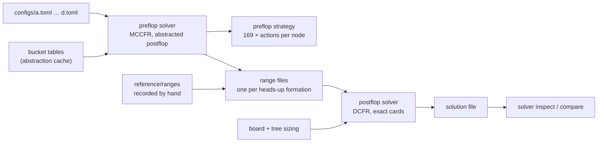
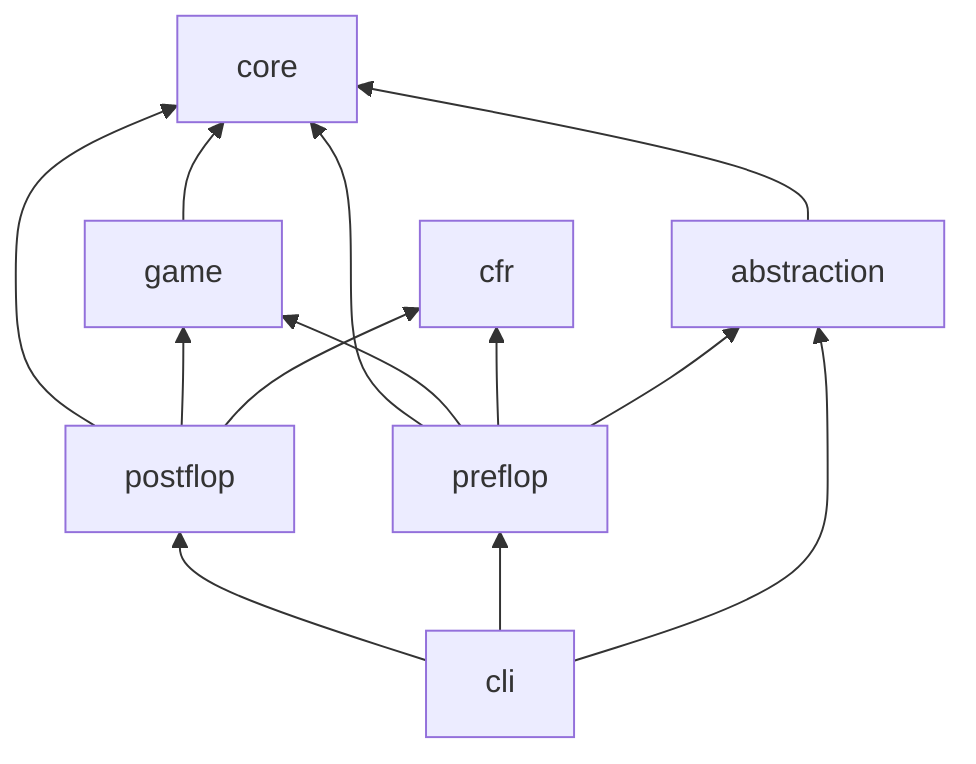

# Architecture

Design written before any code. The requirements are in [BRIEF.md](../BRIEF.md). Choices made while planning, and the questions still open, are in [DECISIONS.md](DECISIONS.md). The order of work is in [ROADMAP.md](ROADMAP.md).

## Overview

Two solvers share one library and are joined by range files. The preflop solver writes one range file per heads-up formation. The postflop solver reads a range file plus a board. Range files recorded by hand from a reference source use the same format, so the postflop solver can be used before the preflop solver exists.



## Crate graph

Arrows point from a crate to the crates it depends on.



| Folder | Package | Holds |
| --- | --- | --- |
| `crates/core` | `pk-core` | cards, card sets, combos, 169 classes, ranges, evaluator, equity, suit isomorphism, hand indexer |
| `crates/game` | `pk-game` | `GameConfig`, positions and action order, betting-tree builders, range-file format |
| `crates/cfr` | `pk-cfr` | regret matching, discount schedules, toy-game CFR and MCCFR, best response, vector-form helpers |
| `crates/abstraction` | `pk-abstraction` | equity histograms, k-means, bucket tables |
| `crates/postflop` | `pk-postflop` | heads-up flop-to-river solver, solution files |
| `crates/preflop` | `pk-preflop` | N-player MCCFR over the abstracted game, checkpoints, range export |
| `crates/cli` | `pk-cli` (binary `solver`) | every command |

Packages are prefixed `pk-` because a crate named `core` collides with Rust's built-in `core` crate.

Rules:

- **`cfr` knows nothing about poker.** It works on slices and on a small game trait. Kuhn and Leduc test the same regret code that both solvers use.
- **Library crates never print.** They return results and report progress through a callback. Only `cli` writes to the terminal.
- **Few dependencies, all permissively licensed:** `rayon`, `serde` + `toml` + `serde_json`, `rand` + `rand_chacha`, `zstd`, `memmap2`, `thiserror` in libraries, `windows-sys` in `postflop` on Windows only, for the peak resident memory (DECISIONS P43), and `anyhow` + `clap` in `cli`, with `criterion` and `proptest` for development only. No AGPL dependency, and no AGPL code copied (brief, Validation).

## Conventions

- **Chips are integers.** Every amount is a `u32` count of chips, with 1 bb = 100 chips. Bet sizes are computed in `f64` and rounded to whole chips by one function, and a tree never holds two actions with the same rounded amount. The config loader rejects amounts that are not whole chips.
- **Cards.** `Card(u8)` is `4 × rank + suit`, with rank 0 the deuce and rank 12 the ace. `CardSet(u64)` is a bitmask. The 1,326 combos have a fixed index order. The 169 hand classes use the 13×13 grid order: pairs on the diagonal, suited hands above it, offsuit hands below it.
- **Positions are named by role:** UTG, UTG1, LJ, HJ, CO, BTN, SB, BB at the 8-handed table every config uses. Names for other table sizes are derived from the player count. The straddler keeps the name UTG, because the straddle is only a forced bet attached to that position. This keeps formation names the same across configs.
- **Determinism.** Every random draw comes from a seeded `ChaCha8Rng`, and seeds are recorded in run metadata. Parallel postflop code collects per-branch results and reduces them in a fixed order, so results are bit-identical for any thread count. Multi-threaded preflop MCCFR is not deterministic, because it uses lock-free updates. It has a single-thread mode that is, and tests use that mode.
- **Floats.** Regrets and strategies are stored as `f32`, then compressed. EVs, exploitability and test oracles accumulate in `f64`.
- **Slow tests** are marked `#[ignore = "slow"]` and run with `cargo test --release -- --ignored`. The fast suite should stay under about a minute.
- **Algorithms come from papers.** Doc comments cite the paper each algorithm follows.

## core

- **Evaluator.** `evaluate(CardSet) -> HandRank`, where `HandRank: Ord` stores the category in its high bits. It is written from scratch with bitmasks: per-suit 13-bit rank masks, flush and straight detection with bit tricks (wheel included), and rank counts for pairs and trips. Speed is secondary. The postflop solver sorts each river board's hands once, and the abstraction reuses that sweep, so the evaluator is not in any inner loop. Benchmark it, and replace it with a table evaluator only if a measurement shows it matters.
- **Equity.** Exact enumeration for hand against hand on any partial board, weighted range against range with card removal, and a seeded Monte Carlo mode that reports its standard error.
- **Suit isomorphism.** Canonicalizes a board under suit permutation, maps combos through a permutation, and lists the distinct cards that can be dealt next, with a multiplicity for each.
- **Hand indexer.** A perfect index over canonical (hole cards, board) per street: 169 preflop, 1,286,792 flop, 13,960,050 turn, 123,156,254 river. It is implemented from Waugh, *A Fast and Optimal Hand Isomorphism Algorithm* (2013). Only the abstraction needs it.
- **Ranges.** `Range` is 1,326 `f32` weights. Standard range-string syntax is described under [Range file](#range-file).

## game

### GameConfig schema

One struct drives everything. A straddle is one more live blind, and an ante is a dead forced bet. No solver code checks whether a game has a straddle. Config C looks like this:

```toml
name = "C"
description = "100bb, UTG straddle, ante"
players = 8
stack_bb = 100.0        # before forced bets; blinds and antes come out of it

[[forced_bets]]
position = "SB"
amount_bb = 0.5
kind = "blind"          # live: counts toward a call, poster gets the option

[[forced_bets]]
position = "BB"
amount_bb = 1.0
kind = "blind"

[[forced_bets]]
position = "UTG"
amount_bb = 2.0
kind = "blind"          # the straddle

[[forced_bets]]
position = "ALL"        # every seat posts
amount_bb = 0.5
kind = "ante"           # dead: goes to the pot, never counts toward a call

[rake]
percent = 5.0
cap_bb = 6.0            # the same in all four configs (D16)
no_flop_no_drop = true

[preflop]
open = 2.5              # × the effective blind (largest live forced bet)
open_sb = 3.0
threebet_ip = 3.0       # × the raise faced
threebet_oop = 4.0
fourbet = 2.3
allin_threshold = 0.40  # offer all-in once a raise would commit > 40% of stack
limps = false
max_raises = 4

[postflop]               # exact postflop solver
flop  = { bets = [0.33, 0.75], raises = [3.0], allin = false }
turn  = { bets = [0.33, 0.75], raises = [3.0], allin = false }
river = { bets = [0.33, 0.75], raises = [3.0], allin = true }
max_raises = 3           # raises per street after the opening bet, all-in raises included
allin_threshold = 0.67   # a bet or raise that would commit more than 67% of the stack goes all-in

[abstract_postflop]      # the small tree inside the preflop solve
bets = [0.75]
raises = [3.0]
allin = true
```

Postflop bets are fractions of the pot, and raises go to a multiple of the bet faced. `allin = true` adds all-in as one more bet and one more raise. Two rules apply to every street (DECISIONS P15). `max_raises` caps the raises on a street after its opening bet, and 0 means no raises. `allin_threshold` turns into all-in any bet or raise that would leave a player with more than that fraction of the effective stack put in; 1 turns nothing. All sizes are placeholders to tune.

Preflop sizes are multiples of the **effective blind**, which is the largest live forced bet. A 2.5× open is therefore 2.5bb in configs A and B and 5bb under a 2bb straddle, and the straddle needs no sizing table of its own (DECISIONS P2).

In configs C and D the pot holds 7.5bb before the first action: 0.5 + 1 + 2 from the blinds and straddle, and 8 × 0.5 from the antes. Every seat is left with 99.5bb (C) or 199.5bb (D) to bet.

The loader rejects configs with fewer than 2 or more than 9 players, unknown positions, amounts that are not whole chips, stacks smaller than the forced bets, forced bets that leave unequal live stacks, empty bet lists, a bet size above 10 pots or a raise size above 20 times (almost certainly a percent typed where a fraction or a multiple belongs), or an all-in threshold that is not more than 0 and at most 1. Every error names the field.

### Positions and action order

These rules derive the order from the forced bets alone:

- The seat after the last live blind acts first preflop, and that blind's poster closes the preflop action.
- Postflop, the SB acts first and the BTN acts last.
- Antes go into the pot and never count toward a call.

| Config | Preflop order | Postflop order |
| --- | --- | --- |
| A, B | UTG UTG1 LJ HJ CO BTN SB BB | SB BB UTG UTG1 LJ HJ CO BTN |
| C, D (UTG straddle) | UTG1 LJ HJ CO BTN SB BB UTG | SB BB UTG UTG1 LJ HJ CO BTN |

Button (Mississippi) straddles are not modelled (DECISIONS D15). They can't be derived this way and would need an explicit first-to-act field in `GameConfig`.

**Side pots.** None are needed. The postflop solver is heads-up and plays to the effective stack. Preflop showdowns can be multiway all-ins, but every seat starts with the same stack and posts the same ante (DECISIONS D14), so live stacks are always equal. The loader rejects a config whose forced bets leave them unequal, as a big blind ante would (DECISIONS P7).

### Betting trees

- **Arena layout.** A tree is a `Vec<Node>` addressed by `u32` index, in depth-first pre-order from the root at index 0, so every subtree is a contiguous range. A node is one of these:
  - `Player { street, actor, actions, children }`
  - `Chance { street, child }`, which deals `street`
  - `Terminal { street, outcome: Fold { winner } | Showdown, contributions }`

  Contributions are the chips each player put in during the tree, and the pot is the root pot plus both. The tree does not depend on the cards. A chance node has one child, the betting that follows whatever card falls, and the solver keeps per-card data itself.
- **Two builders.** The heads-up postflop builder (`pk_game::tree`, M3) takes the root street, the pot, the effective stack and a `PostflopSizing`. That is `[postflop]`, or `[abstract_postflop]` repeated on every street. The N-player preflop builder (M7) reads `[preflop]`. Both use the rules in `pk_game::rules`, which never assume two players: whole-chip rounding, the minimum raise, the all-in conversions, the raise cap and duplicate removal.
- **Postflop rules.** The `pk_game::tree` module documentation states them precisely. In short:
  - OOP acts first on every street.
  - With no bet to face, a player checks, or bets `f` × the pot for each entry of the street's `bets`, at least 1bb.
  - Facing a bet, a player folds, calls, or raises to `m` × the bet faced for each entry of `raises`. A raise is lifted to the minimum raise if smaller: the bet faced plus the last bet or raise increment.
  - `allin = true` adds all-in as one more bet and raise. After `max_raises` raises on a street, all-in raises included, only fold and call remain.
  - A size becomes all-in if it would use every chip, or leave the player with more than `allin_threshold` of the root effective stack put in, counting earlier streets. A player short of a minimum raise may still raise all-in.
  - Sizes are rounded to whole chips by one function: to the nearest chip, halves up. Sizes that land on the same amount are one action, named by the smallest size.
  - Actions are ordered check, or fold then call, followed by wagers from smallest to largest. All-in, when offered, is last.
  - A call or a check behind ends the street. On the river that is a showdown. Earlier, it leads to a chance node and the next street. Players who are all-in before the river pass through the remaining chance nodes to a showdown, with no decisions.
- **Tokens.** Each action prints its path token: `x`, `c`, `f`, `b33` (from the size 0.33), `r3` (from the size 3) or `a`. A size lifted by the minimum bet or raise keeps its token. `PostflopTree::find` takes a path of tokens, such as `x b50`, to its node, and an error names the token that did not match and lists the actions available there. A path stops at a chance node of the betting tree. The postflop game's public tree, which has a node for every card, reads card tokens as well, as in `x b50 c 7s x` ([the game](#the-game)).
- **Size limit.** The builder refuses a tree of more than `max_nodes` nodes, one million by default (about 100 MB), instead of allocating without bound. Trees with many sizes over three streets grow fast.
- **Node counts.** Every tree reports node counts per street: player nodes, actions, chance nodes, folds and showdowns. A chance node counts on the street it deals. The memory estimators start from these counts.

## cfr

Each module's doc comment is the exact specification of what it computes. This section is the map.

- **`regret`.** Regret matching and regret matching+ over `[actions × hands]` slices, with these schedules:
  - vanilla CFR
  - CFR+
  - linear CFR
  - discounted CFR with α, β, γ, defaulting to 1.5, 0 and 2 as in Brown and Sandholm (2019)

  These are pure functions that every solver shares. Iterations count from 1, and the discount of iteration `t` is applied after that iteration's regret and strategy have been added (DECISIONS P18).
- **`tabular`.** A `Game` trait for small games with any number of players, and `Cfr`, which walks the whole tree on every iteration. Players update in turn within an iteration, player 0 first. `Profile` holds a strategy per information set, and `expected_values` gives each player's value under one.
- **`best_response`.** The exact best response, chosen per information set, and exploitability for two-player zero-sum games: the average of the two best-response values.
- **`kuhn` and `leduc`.** The two test games. Leduc treats its six cards as distinct, which gives 936 information sets (DECISIONS P21).
- **`mccfr`.** External-sampling MCCFR over the same `Game` trait, seeded and reproducible. The average strategy accumulates in a separate pass that samples the player's own actions, and discounts are applied lazily when an information set is next touched (DECISIONS P19).
- **`vector`.** `PublicGame` is the trait a game implements for public-tree CFR: the tree, the deal, the hands a chance outcome rules out, and the values at a terminal given the opponent's reach. `VectorCfr` is the solver over it. Each player node holds per-hand arrays, and a traversal passes the opponent's reach vector down and returns per-hand counterfactual values. A walk allocates nothing per node: each node with children holds its vectors in a frame from a stack of frames, one per depth, kept from walk to walk, and the game gets room of its own at a terminal, so that after the first iteration an iteration allocates nothing (DECISIONS P45, P46). Called on a thread of a rayon pool of more than one thread, the walks of an iteration, a best response and an expected value run the children of the first chance node on each line as rayon tasks, each on the rows of its own subtree and with a workspace of its own, and the chance node adds up the values they return in outcome order, so that every result is bit for bit the walk on one thread's whatever the thread count; outside a pool, or on one thread, they run on the calling thread as before (DECISIONS P51 to P54). A chance outcome may have *images*, other outcomes the game has merged into it, each given by a permutation of each player's hands (`PublicGame::images`, none by default): every walk walks the outcome's subtree once and adds, after its values, each image's, read through its permutation, in the game's order on one thread and in the parallel walk alike (DECISIONS P57). A game may also name the hands that are *alike* at a node, whose values a symmetry makes equal (`PublicGame::alike`, none by default): the CFR walk gives each hand its class's first hand's value at every terminal and chance node, so that floating point cannot round alike hands apart (DECISIONS P63). How `VectorCfr` holds its regrets and strategy sums is its second type parameter, a sealed `Storage`: `F32Storage`, the default, as `f32` slices updated by `regret`'s functions, or `CompressedStorage`, as 16-bit codes with one scale per node (`compressed`, below; DECISIONS P65). `public_leduc` puts Leduc on the trait. `vector_best_response` gives best response, each player's expected value under a profile, and the zero-sum exploitability in the same form, each validated against its scalar counterpart on Leduc; `vector_best_response_value` gives a best response's value by the same walk without keeping its strategy, which is what a measurement needs (DECISIONS P64).
- **`compressed`.** Regrets as `i16` codes and strategy sums as `u16` codes, each node's slice with one `f32` scale. Regrets are requantized at every update, the scale set by the slice's largest magnitude; strategy sums take the discount on the scale, add each increment to its code, and are requantized only when a code would overflow. Regret matching and the average strategy read the codes, since neither depends on the scale. Every code is rounded with one offset for the node's update, from a Weyl sequence over the iterations that starts at a place hashed from the node, so that the rounding errors of a slowly changing value cancel over the iterations, and alike hands and the thread count change nothing (DECISIONS P66). It halves the memory of the regrets and strategy sums, and a solve under it stops improving at a few thousandths of a percent of the pot where an `f32` solve goes on ([BENCHMARKS.md](BENCHMARKS.md#16-bit-storage-41)).

The preflop solver samples private cards, so its regret updates are scalar per information set. The postflop solver needs the vector form so that range-against-range terminal evaluation costs O(n) instead of O(n²). Both forms are validated on Leduc in M2, before either poker solver exists.

**How the vector form is held to the scalar one.** From the same stored state, one iteration of each agrees within one `f32` rounding under every schedule, checked for 5,000 iterations on Leduc. Run side by side on Leduc, vanilla CFR and DCFR match exactly at every count up to 5,000, while CFR+ and linear CFR part after about 10 and 130 iterations. The cause is rounding, not a difference in the algorithm: every schedule but vanilla CFR can grow a one-ulp difference in a single regret past 1e-6 within tens of iterations, and DCFR matches on Leduc only because its two runs rarely round differently (DECISIONS P20). Any change that reorders a sum, such as a faster terminal sweep or a threaded reduction, should therefore be checked one iteration at a time from the same state, not by comparing long runs.

**Precision.** `f32` storage sets two limits. CFR+ and DCFR stop improving on Leduc near an exploitability of 1e-5 chips, which is far below the postflop target; under 16-bit storage the floor is near 2e-4 chips (DECISIONS P66). And the schedules stop weighing iterations as documented after about 10^7 iterations: the linear discount rounds to 1 from iteration 2^25, and a strategy sum fed 1 per iteration stops growing at 2^24. Postflop solves run thousands of iterations, so only the preflop solver has to deal with this, with wider storage for long runs ([#84](https://github.com/Ollienel777/poker-solver/issues/84)).

## postflop

The input is a `Spot` (see [Spot file](#spot-file)): the `board`, the `oop_range` and `ip_range`, the `pot` and `effective_stack`, the `tree` sizing, and the rake as `rake_percent` and `rake_cap`. From it the solver takes the starting street, the built tree, the `BoardHands` and the `Rake`. Each iteration updates the two players in turn. For each player, a traversal carries the opponent's reach vector, computes counterfactual values, applies the DCFR discount and accumulates the average strategy. Exploitability is computed every k iterations. The solve stops at a target (default 0.3% of pot), an iteration cap or a time cap.

Spots on the flop, the turn and the river are solved by the same code. A river spot is the case with no chance node, and solves bit for bit as it did in M3.

### The game

`pk_postflop::PostflopGame` turns a spot on any street into a `pk_cfr::PublicGame`, so that `pk_cfr::VectorCfr` solves it. `PostflopGame::from_spot` refuses a spot that fails `Spot::validate`, a betting tree over its node limit, and a public tree over the limit below, each as an error. `pk_postflop::RiverGame` is the same type under the name M3 gave it, which the river's tests still use. Its constructor `RiverGame::new` still refuses a board of other than five cards (`SolveError::NotRiver`), so that code that needs a river game cannot be handed a flop game (DECISIONS P27). The dump, its import and the comparison handle every street (DECISIONS P30).

- **Public tree.** The betting tree's chance node has one child, the betting after whatever card falls. The public tree expands it (DECISIONS P23): each chance node has one child per card off its board, in card order, each the root of a copy of the betting below it. Every public node knows its betting node (`tree_node`) and its board (`board`), and the nodes are in pre-order, so every subtree is a contiguous range. A player node's actions are its betting node's, in the tree's order, and the acting player is the actor's index, 0 for OOP and 1 for IP. On a river spot the public tree is the betting tree node for node.
- **Chance.** Once both players hold their hands, the next card is equally likely to be any of the `48 − |board|` cards neither holds. So every outcome of a chance node has probability `1/(48 − |board|)`, 1/45 for the turn and 1/44 for the river, and rules out the hands that hold its card. For any two hands that can be held together at the node, the outcomes that rule out neither sum to 1 (DECISIONS P24).
- **Hands.** Each player's hands are its `HandList` on the spot's board: the in-range combos that miss it. Blocked and out-of-range combos have no hand index, so each player node stores regrets and strategy sums, as `f32`, for the acting player's in-range combos only (DECISIONS P9). The lists are the same on every street: a hand that holds a turn or river card is ruled out below it, keeps its place in every vector there with reach zero, and plays uniformly (DECISIONS P25).
- **Deal.** Chance deals OOP `h` and IP `o` with probability `w_0(h) · w_1(o) / Z` when the two combos share no card, where `Z` sums that product over the pairs that can be dealt on the spot's board. The deal vectors are `w_p / √Z`, so every value is in chips per hand dealt.
- **Terminals.** Each betting terminal's `Payoff` is computed once, with the rake, from the chips put in since the spot started. A public terminal is evaluated on its own board (DECISIONS P26): a fold with `BoardHands::fold_values`, on any street, and a showdown with `showdown_values`, always on a river board, both O(n) with card removal. The game builds a `BoardHands` for every board the public tree reaches, the spot's, each turn and each river, so a river board's hands are ranked once and serve every showdown on it; the river reached by the cards `a` then `b` shares its board with `b` then `a`. A later board's hand lists hold only the hands that miss it, so the opponent's reach is gathered into its order and the values written back by an index into the spot's lists, with 0 for the hands that hold a dealt card. An all-in called before the river runs out through the chance nodes to a showdown on every river.
- **Size.** A flop line that reaches the river is copied 49 × 48 times. The game counts the public tree's nodes from the betting tree before building anything, and refuses one over its limit with `SolveError::PublicTreeTooLarge` (DECISIONS P28). The limit is `SolveOptions::max_nodes`, one million by default, the betting tree's own default. It bounds the tree, not the solver's storage, which grows with the hands too; the [memory estimate](#memory-model) bounds that.
- **Node paths.** A public node is named by the actions and the cards from the root to it, as tokens separated by spaces: `x b50 c 7s x` is OOP's check, IP's half-pot bet and OOP's call on the flop, the seven of spades, and OOP's check on the turn. `PostflopGame::find` turns a path into a node, and says which token failed and why: an action that is not one at its node, a token at a chance node that is not a card or is a card on the board, or a token after the end of the hand. `PostflopGame::node_path` gives a node's path (DECISIONS P29).
- **Reading a strategy.** `PostflopGame::reach` gives each player's own reach of a node by hand: its own action probabilities on the way multiplied, and 0 for a hand that holds a card dealt on the way. Summed over the acting player's range at a node, a strategy answers two different questions, with two read-outs that differ by up to several points:
  - **How often each action is taken once the node is reached.** `hand_weights` gives the probability that the acting player holds each hand once the node is reached, including card removal by the opponent's range there, and `action_frequencies` the probability of each action at the node under those weights. Use it for the probabilities of play, such as how often a bet is called.
  - **What a range view shows.** `range_view_weights` weighs each hand by the acting player's own combos alone, range weight times own reach, with no card removal by the opponent's range, and `range_view_frequencies` gives each action's frequency under those weights. This is what a solver's range view shows and what the cross-solver comparison uses. Below a card, the hands that hold it are not in the range.

  `range_view_classes` groups the range view by the 169 hand classes, with each class's share of the range and its frequency for each action, and `reach_probability` gives how often play reaches a node, the chance of each card dealt on the way included, so that it sums over a chance node's children to the chance node's. Each works at any player node of the public tree, on any street, as does each hand's strategy. The example `solve_spot` in `pk-postflop` prints these for a spot file, at a node given by its path.

  On `four_flush` at 0.05% of the pot, IP's re-raise facing OOP's check-raise is 10.1% by the first and 18.7% by the second. A test in `pk_postflop::river` pins the two apart so that neither is turned into the other.

### The merged game

`pk_postflop::MergedGame` is the game the solver iterates on when a relabelling of the suits keeps the spot's deal (#39, DECISIONS P56 to P59). `Γ` is the relabellings that map the spot's board onto itself as a set and leave both hand lists as they are, weights included. At a chance node, the members of `Γ` that also keep each card dealt since the spot began sort the cards that can fall into classes; each class is dealt once, by its lowest card, and each other card is an image of it, through the relabelling that maps it to the representative. A member of `Γ` is an automorphism of the game, and CFR from zero keeps the full game's state symmetric under it, so the subtree after an image is the representative's with the hands relabelled, and the merged iteration is the full game's in exact arithmetic; in floating point the two agree within rounding. A relabelling that keeps the cards on the board but moves a dealt card onto another (flop 7s 7h 2c, turn 7d, hearts and diamonds swapped) describes a node of another game and is never used. The module documentation gives the argument in full.

- **Shared with the full game.** The merged game borrows the full game and shares its boards, hands, deal and payoffs, so its terminals are evaluated as the full game's are. Its own nodes are the full tree's with the subtrees after images left out, in pre-order, and the solver stores regrets and strategy sums for them only.
- **Counterparts.** Every node of the full game has a counterpart in the merged game and a relabelling `τ` in `Γ`: the node's subtree, every hand `h` written `τ(h)`, is the counterpart's. `MergedGame::average_strategy` expands a solver's average strategy onto the full tree through them.
- **Kept symmetric.** The argument needs, at every chance node, the opponent's reach to be the same for each hand and its relabelling, that is, the solver's stored values at every merged node to be the same for `h` and `σ(h)` under the node's stabilizer, the members of `Γ` that keep each street of its board. Floating point breaks that by itself: a terminal's and a chance node's sums add the two hands' terms in different orders, and regret matching at zero turns a last-bit difference into a different strategy, on `monotone_pot` within 5 iterations. So each merged node names its stabilizer's orbits of hands as alike, and the CFR walk gives each hand its orbit's first hand's value at terminals and chance nodes; the stored values of alike hands are then equal bit for bit after every iteration, on any number of threads, and the merged iteration is the full game's in exact arithmetic whatever its state (DECISIONS P63).
- **Measured on the full game.** Each measurement, and the solution, use the expanded strategy on the full game, by code that assumes no symmetry, so every measurement of a merged solve is an independent check of the merging (DECISIONS P58).
- **When there is nothing to merge.** `MergedGame::new` gives none when `Γ` holds the identity alone, as on an unpaired rainbow flop, a turn of four suits or with ranges that name single combos, or when the spot has no chance node; the solve then iterates on the full game, bit for bit as before (DECISIONS P59).

### The solve loop

`pk_postflop::solve(spot, options, progress)` builds the spot's game, on any street, and runs `VectorCfr` with alternating updates. It returns a `Solution`. `SolveOptions` holds:

| Field | Default | Meaning |
| --- | --- | --- |
| `schedule` | DCFR(1.5, 0, 2) | the regret and averaging schedule |
| `target` | 0.3 | stop once the average strategy's exploitability is at or below this percent of the pot; `None` runs to a cap |
| `max_iterations` | 10,000 | the iteration cap |
| `max_time` | none | the time cap, counted from the call |
| `check_every` | 10 | measure exploitability after every this many iterations |
| `max_nodes` | 1,000,000 | refuse a public tree of more nodes, before building it |
| `max_memory` | 10 GB (10^10 bytes) | refuse a solve whose [memory estimate](#memory-model) is larger, before building the game (DECISIONS D17, P42) |
| `threads` | all the machine offers (`std::thread::available_parallelism`) | the threads the walks run on, in a rayon pool of the solve's own when there is more than one and the spot has a chance node; the results are the same for every count (DECISIONS P5, P52) |
| `merge_isomorphic` | true | iterate on the [merged game](#the-merged-game) when a relabelling of the suits keeps the spot's deal; off, or with nothing to merge, the solve iterates on the full game exactly as before (DECISIONS P56 to P59) |
| `compressed_storage` | false | store the regrets and strategy sums in 16 bits with a scale per node (`pk_cfr::compressed`), in half the memory and at a cost in exploitability and time; off by the user's decision at the M4 gate ([BENCHMARKS.md](BENCHMARKS.md#16-bit-storage-41); DECISIONS D23, P65, P66) |

The target is checked after each measurement, and the caps before each iteration. When several rules hold at once, the target wins, then the iteration cap, then the time cap. If the solve stops after an iteration it did not measure, it measures once more. That last measurement does not change the rule reported: a solve stopped by a cap reports the cap even when the measurement turns out to be at or below the target, so compare the exploitability with the target to know whether it was met. The solve keeps the last measurement's profile, which the solution takes if the solve stops there, and drops it before the next measurement builds another, so that it holds one at a time; its best responses keep no strategy; and once it stops, the solver is dropped and the game moved into the solution (DECISIONS P64). The `progress` callback receives one `Progress` (iterations, elapsed time, exploitability) per measurement, in order, and its last call matches the solution. The library never prints. Measuring only reads the average strategy, so the strategy after `t` iterations is bit-identical whatever the measurement interval and caps.

The `Solution` lives in memory; the solution file comes in M5. It holds the stopping rule that ended the solve, the iterations, the elapsed time, the `Exploitability` (each player's value, best-response value, and the exploitability in chips and as a percent of the pot) and the average strategy. Read access covers each hand's action probabilities at each node of the public tree, and the reach and both read-outs above: hand weights and action frequencies, and range-view weights and frequencies. Node indices are the public tree's, which `Solution::game().find` gives from a path.

### Exploitability

`pk_postflop::exploitability(game, profile)` measures the average gain from deviating (DECISIONS P17):

```text
exploitability(σ) = ((BR_0(σ) − v_0(σ)) + (BR_1(σ) − v_1(σ))) / 2
```

Here `v_i` is player `i`'s expected value when both players follow `σ`, and `BR_i` is its value when it best-responds to the other's `σ`. Both are in chips per hand dealt, and the result is reported as a percent of the root pot. Payoffs count from the start of the tree, so `v_0 + v_1` is the pot minus the expected rake, not zero, and the zero-sum `(BR_0 + BR_1) / 2` of `pk_cfr::best_response` would be about half the pot at an equilibrium. The computation is four walks of the public tree: `pk_cfr::vector_best_response` and `pk_cfr::vector_expected_value` for each player. It is the same on every street: the walks average over the turn and river cards at the chance nodes, and a best response chooses with the cards dealt so far.

### Validation

- **The toy game.** `toy_polarized` reaches its analytical equilibrium: OOP bets every nut combo, bluffs are 1/4 of its bets, IP calls 2/3 of the time, and the values are 40/11 and 70/11 bb.
- **An independent scalar check.** For two small raked spots, the test builds the same game as a scalar `pk_cfr::Game` from first principles. Its ranges share combos and cards, and it plays ties and a capped rake. Chance deals compatible pairs by the product of the range weights, the betting follows the tree, and the payoffs come from the chips and the hand evaluator. It agrees with the river game on every deal probability and every terminal payoff. It also agrees on both players' values and best responses under fixed and random profiles, and on every stored value after one CFR iteration from the same state, under four schedules. The scalar game also re-measures the exploitability of two solved reference spots.
- **Rake.** `pk_postflop::expected_rake(game, profile)` gives the probability of ending at each terminal and the rake taken there, worked out from the contributions and the rake settings rather than from the payoffs. It walks the tree itself and removes the pairs of hands that share a card by counting cards, in O(n) per terminal. On every river spot the solved values sum to `pot · M − E[rake]` within 7e-13 chips. `M`, the probability of ending at some terminal, is 1 up to the `f32` rounding of the strategies (within 2e-8), so the values sum to the pot less the expected rake. The terminal probabilities match the O(n²) sum over every pair, a raked spot's values are lower by the expected rake than the same strategy's without rake, and the scalar game's values sum to the same.
- **Every river spot** solves to 0.3% of the pot in the fast suite. A slow test (`river_spot_table`) prints the iterations to 0.3%, 0.1% and 0.03%, the time per iteration and per measurement, and the share of the time spent in terminal evaluation.
- **Turn and flop.** Two small raked spots in `crates/postflop/tests/data`, `turn_small` and `flop_small`, whose ranges share combos and cards, check the game of a spot that starts before the river (`tests/chance_nodes.rs`), each check against a definition that shares nothing with the library but the evaluator, the card types and the public tree's shape:
  - The public tree follows the betting tree node for node, each chance node deals every card off its board once and rules out exactly the hands that hold it, and the trees have the 2,085 and 121,388 nodes counted by hand from the tree rules. A river spot's public tree is its betting tree.
  - At every chance node, for every pair of hands that can be held together there, the outcomes that rule out neither sum to 1.
  - When both players only check, each hand's value at the root is the pot less its rake times the hand's exact equity against the other range, from `pk_core::range_vs_range`, on both spots.
  - Raked folds on the flop, the turn and the river, and all-ins called on the flop and the turn, are each checked against a double loop over the hands, and over every runout for the all-ins, with payoffs worked out from the chips. The opponent's reach on the hands that hold a dealt card is left out even when it is not zero.
  - Under a random profile, both players' values from the vector walk equal the average over every pair of hands of its payoff, walked line by line and card by card (within 1e-9 of the pot; measured, 1e-13).

  Nine bugs put into the game one at a time, among them a wrong chance probability, an outcome that rules out nothing, the wrong board for a card, a fold evaluated on the spot's board, and values written back to the wrong hand, each fail at least one of these tests. The turn spot solves to 0.3% of the pot in the fast suite, in 60 iterations, and its uniform starting strategy is exploitable by 36.6% of the pot, with both players gaining. The flop spot's solve, 60 iterations to 0.21% in 14 s in release, is a slow test (`the_flop_spot_solves_to_its_target_and_keeps_every_invariant`) that prints the sizes and the solve. The read-outs below a card are checked against their definitions on the solved turn spot (`tests/turn_flop_solve.rs`).
- **The gate's turn and flop fixtures.** Seven spots in `reference/spots/turn/` and `reference/spots/flop/`, on the BTN vs BB lines at 100bb (`reference/README.md`): four flops, with no, two and three suits alike, and three turns. `tests/street_spots.rs` loads each one, builds its tree and its game within the default node limit, and checks that it writes back unchanged. It walks every tree for sizes that are whole chips, at least 1bb, and each an action of its own at every node (DECISIONS P38), checks that each rake cap binds in some pots and not in others, that the ranges keep every symmetry of their board's suits (DECISIONS P50), and that the set covers what it is meant to stress, and holds the README's tables to the files.
- **Merging suit-isomorphic cards.** Six small spots in `crates/postflop/tests/data`, written for these checks with ranges in hand classes, hold the [merged game](#the-merged-game) to the full one (`tests/merged.rs`): a monotone flop, a two-tone flop, a paired flop, an unpaired rainbow flop, which nothing merges, a turn of four clubs, and a monotone flop whose ranges name AcQc and AdQd but not AhQh, so that the hearts the board alone would merge are kept apart. Each check compares with the full game's solver or measurements, which assume no symmetry:
  - The classes at each chance node are those the board and the ranges allow, and every full node's counterpart is on the same betting node, on its board relabelled by a `τ` that keeps both hand lists.
  - After 1, 2 and 3 iterations from zero, under every schedule, every regret and strategy sum of the full solver equals the merged solver's at its node's counterpart with the hands relabelled, within four `f32` roundings of the largest value in its slice; measured, at most 2.5e-16 of it. Seven mistakes put into the merging one at a time (an image read through the identity, or through the inverse of its relabelling, a missed image, an image counted twice, classes that ignore the ranges, classes from a chance node's board alone, and relabellings composed in the wrong order) each fail this check: the classes that ignore the ranges because the check refuses a `τ` that does not keep OOP's hand list, and the six others on the values, at a gap of 2.9e-3 to 1.07 of a slice (the wrong composition once the merged game's own debug assertion, which catches it first, is taken out).
  - After 300 iterations, merged and full solves are within 0.01% of the pot in exploitability and values (measured, 0.0021% and 0.0012% at most). Strategies are not compared: the full solver parts from its own relabelled subtrees at a hand indifferent between its actions as far as it parts from the merged solver (DECISIONS P60).
  - With merging off, or on the rainbow flop, a solve is the full solver's bit for bit; on several threads a merged solve is the merged solve on one, bit for bit (`tests/threads.rs`).
  - The merged solver stores the same values bit for bit for `h` and `σ(h)` at every merged node, for `σ` in the node's stabilizer, under every schedule, on one thread and on four, on the five spots above and on `flop_monotone_wide`, a monotone flop with about 190 and 160 hands a side on which, without the alike hands of DECISIONS P63, two such hands part by iteration 8 under every schedule.
  - A spot with its suits relabelled solves to the spot relabelled: after 3 iterations every probability is the same and the values within 2e-14% of the pot, and after 300 the values and the exploitability within 0.001% of the pot (DECISIONS P61). This is the M4 gate's "suit-isomorphic boards give identical results".
- **Invariants.** `pk_postflop::check_solution(&solution)` returns a `Report` of every way a solution breaks the invariants every solve must keep, each with the invariant, the node, the hand and the numbers. Each hand's probabilities at a node sum to 1 within 1e-6. Each reach is its parent's times the probability of the action taken, within 1e-14, and below a chance node the parent's with 0 for the hands that hold the card dealt. The values sum to `pot · M − E[rake]` from `expected_rake`, within 1e-13 of the largest pot. No number is NaN or infinite. The tolerances come from the margins a slow test (`invariant_margins`) measures on the river; the turn and flop spots stay well inside them (worst 1.0e-7 and 9.1e-8 for the strategy sums, 0 for the reaches, 4.5e-16 and 2.5e-15 for the value sum). The checks and `expected_rake` walk the public tree, so they cover every street. Identical results on suit-isomorphic boards are checked by `tests/merged.rs` (below), not by `check_solution`, since they need two solves. In a build with debug assertions, `solve` checks every solution it returns and panics with the report, at about the cost of one exploitability measurement, and the tests check every solve they make in release too. Unit tests put one fault at a time into a solved spot and confirm that the check reports exactly that fault.

### Cross-solver comparison

The check against another solver, which is only ever run as a separate program whose output is read (brief, Validation). The reference is postflop-solver (DECISIONS D18). It is a library, so it is run through `postflop-ref`, a wrapper program that reads a spot file and writes a [solution dump](#solution-dump). The wrapper links AGPL code and is kept in a repository of its own; nothing here knows which solver it wraps.

- **Dumps.** `SolutionDump` is a solver-neutral JSON form of a solution, described under [Solution dump](#solution-dump): version 1 for a river spot, version 2 for a flop or turn spot, complete or of the first streets only. `SolutionDump::from_solution` writes ours complete, and `from_solution_streets` the first one or two streets of a flop or turn solution, with the per-hand EVs of `pk_postflop::node_values`; `SolutionDump::from_json` and `load` read one strictly. Version 2's reader walks every path through the betting from the dump's own stack, board and hands, so that a deal in the wrong place, amounts that are not street totals where they pass the stack, a step after the hand is over, a card that cannot fall or a row for a hand that holds a dealt card is refused, with the field, before anything is compared (DECISIONS P32).
- **Mapping onto our tree.** `MappedSolution::from_dump(dump, spot)` checks the dump against the spot before reading any probability, in this order, and stops at the first stage that fails: the dump on its own; the board, pot, stack and rake; each player's hands and weights (a dump with the players the wrong way round is reported as such); and the tree, walked from our root through every chance node, every node matched by its path and every action by kind and amount in any order. Each stage lists every difference it finds as a `Mismatch`: a node where the actions differ, with the actions only one side has, a node the dump lacks, a node of the dump's where our hand is over, another player to act, and, where our tree deals a card, the cards that can fall after which the dump has no node, once for the deal (`Mismatch::MissingCards`). Nodes below a difference already reported are not reported again. The tree stage expects exactly the decision nodes of the streets the dump holds, after every card that can fall: our public tree's subtree after a card that cannot fall, which no hand dealt reaches, is not expected, and not a mismatch (DECISIONS P33). The mapped strategy is rounded to `f32`, as ours is stored, and is uniform where the dump has none: at the hands that hold a dealt card, below a card that cannot fall, and on the streets a partial dump does not hold. `MappedSolution::holds` says which nodes are the solution's. A partial solution cannot be measured: its `exploitability` is `None`, and its EVs are measured only at nodes whose whole subtree it holds, such as one facing an all-in before the river (DECISIONS P34).
- **Comparing.** `compare(spot, a, b, tolerances)` maps two dumps and compares them, and `compare_mapped` compares two `MappedSolution`s, either ours (`MappedSolution::from_solution`) or imported, on any street, complete or partial. The `Comparison` is data, with a `Display` for `solver compare`. It holds each strategy's exploitability measured by our code in our game, or for a partial solution its solver's own figure marked as not measured; each player's value at the root under each, measured or, for a partial solution, as reported; every decision node both solutions hold, with its reach and its range-view frequencies under each; on each street, the nodes checked, the largest frequency difference among them and the reach-weighted mean difference; and per hand class at the root the share, the frequencies and the EVs. Both sides are summed by the same functions from their per-hand strategies, with the range-view weighting of [the game](#the-game), so the convention cannot differ between them; a dump carries no aggregate of its own, and an EV written `null` is no EV, never zero. `Comparison::unchecked` lists what could not be checked, and the text says so plainly.
- **Which nodes are checked.** A node is checked when either strategy reaches it more than `Tolerances::min_reach` (1%) of the time **given the cards dealt on its path**: its reach divided by the probability that those cards fall, which is how often play takes the node's line on that runout (`NodeComparison::reach_given_cards`). On the first street no card has been dealt and this is the reach itself, so a river spot is checked exactly as before. Below a deal the raw reach would check nothing, since a node after one turn card is reached at most 1/45 of the time; given its cards each runout's subtree is a game of its own, weighed as a river spot is (DECISIONS P35).
- **The verdict.** `Tolerances` sets the limits; the defaults for the first street are the M3 gate's (DECISIONS D20): each strategy under 0.3% of the pot exploitable, frequencies within 2 points at every node checked, values within 0.2% of the pot. Two EV checks have defaults of their own: each class's EVs at the root within 5% of the pot between the two solutions, and the EVs and values a solution reports within 0.1% of the pot of those our code measures for its own strategy, which catches EVs on another baseline or in other units, made wherever its strategy below the node is known. Below a deal the frequency limit is a separate setting, `Tolerances::frequency_below_deals`, one value below one deal and one below two, which a river spot never uses; its default was proposed from the honest solvers' measurements below (DECISIONS P36) and confirmed at the M4 gate (D21). A partial solution's exploitability is held to the limit as its solver reports it.
- **Running a program.** `ExternalSolver` runs a command template, in which `{spot}` and `{out}` stand for a spot file and the dump to write, with a timeout, captures the end of its output when it fails, and reads the dump. `ExternalSolver::from_env` reads the template from `PK_REFERENCE_SOLVER`, a JSON array of strings; when it is unset there is no reference and the test that needs one does nothing.

What the comparison can tell apart is shown, without a reference, by `tests/compare.rs` on the river: every spot's dump round-trips through JSON and compares identical to itself, with the strategy bit for bit; a dump of a tree with one other bet size fails the tree check, naming both places the trees part; swapped players are caught at the hands; uniform play and a solve stopped after two iterations fail on exploitability; one node's actions swapped fails on frequencies there and on exploitability; EVs on another baseline (zero-sum, in big blinds, or counted from the node) fail on EVs alone; and a hand-written dump of the toy game's analytical equilibrium, pure where our solve mixes, passes. A stand-in program, the test binary itself, exercises the runner and each way a program can fail.

`tests/compare_streets.rs` does the same for the turn and the flop, on the small spots of `crates/postflop/tests/data`: a turn and a flop solution's dumps of every street and of the first one or two round-trip through JSON and compare identical to ours wherever they hold the strategy, a partial one's exploitability reported as not measured; a deal in the wrong place, a node at a deal, and a missing deal are invalid dumps; a missing card is one `MissingCards` at its deal; a row for a hand that holds a dealt card is an invalid dump; amounts that are totals over all streets are refused where they pass the stack, and fail the tree check at the first node of the next street otherwise; a street listed after half the cards, or without one node and its subtree, fails the tree check once, and `complete` that does not match the streets held is an invalid dump; EVs counted from the node, with every street's chips sunk or only the street's, fail on reported EVs alone; a strategy that is right on the flop and wrong below one turn card fails on frequencies there and nowhere else, at nodes whose raw reach is under 1/45, and on exploitability when the dump is complete; a dump has no node after a card that cannot fall, and one that does is invalid; and an EV written `null` compares as none while 0 in its place fails. `src/dump/tests.rs` holds each version 2 rule a file can break to the field it names.

**The gate's tolerance, measured.** The slow test `honest_solvers_table` compares two sound solves of every spot that differ in schedule or iterations. With both at 0.1% of the pot, the frequency limit of 2 points fails sound pairs: DCFR against CFR+ on 2 of the 9 spots (worst 2.98 points), and DCFR at 0.1% against DCFR at 0.02% on 3 (worst 6.17 points, `paired_low_spr`). The differences shrink with convergence, so they are convergence error rather than distinct equilibria: with both at 0.03% every spot passes, the worst at 1.75 points. Values never came within a factor of 3 of their 0.2% limit (worst 0.065%), class EVs reached 3.05% of the pot against their 5% limit, and EVs over the range at deeper nodes, which are reported and not checked, differ by up to 6.9% of the pot, because each side weighs them by its own reaches.

**Below a deal, measured.** The slow test `honest_solvers_table_by_street` (`tests/compare_streets.rs`, about 11 minutes in release) compares DCFR with CFR+, both run to the same target, on three turn spots and a small flop spot, street by street. The largest frequency difference at a node checked (reached more than 1% of the time given its cards), in points, on the first street / below one deal / below two, with the spots' combos a side:

| Spot | Combos | Both at 0.1% | Both at 0.03% | Both at 0.01% |
| --- | --- | --- | --- | --- |
| `turn_wide` | 291 / 312 | 0.85 / 3.57 | 0.18 / 1.67 | |
| `turn_medium` | 85 / 100 | 0.39 / 5.69 | 0.07 / 4.58 | 0.06 / 2.15 |
| `turn_small` | 10 / 9 | 1.27 / 12.72 | 0.60 / 14.73 | 0.08 / 9.20 |
| `flop_wide` | 75 / 137 | 9.64 / 15.93 / 38.90 | 0.74 / 7.73 / 17.99 | |
| `flop_small` | 7 / 8 | 2.36 / 33.64 / 38.32 | 1.06 / 31.56 / 33.59 | 0.46 / 22.62 / 34.08 |

The 0.01% column, and `flop_small`, were measured once by hand with the same comparison, measuring the flop every 5 iterations; the test measures the flop every 10. The share of the nodes checked within 5 points at 0.03% is 99% to 100% below one deal on the turn spots, 97% on `flop_wide`'s turn and 92% on its river; within 10 points, 99% to 100% everywhere.

The first street behaves as the river did: within the M3 gate's 2 points at 0.03% on every spot (worst 1.06, `flop_small`), though not at 0.1% on `flop_wide` (9.64, OOP's choice between its two bet sizes at the root). Below a deal the differences are several times larger at the same exploitability, because the exploitability is an average over the runouts and each runout's subtree is less converged than the whole. They shrink with convergence, as convergence error does: `turn_medium`'s worst river node goes from 5.69 to 4.58 to 2.15 points as the target goes from 0.1% to 0.03% to 0.01%, and its reach-weighted mean from 0.35 to 0.16 to 0.08 points. And they grow as the ranges narrow, where a single hand is a large share of a range and a hand indifferent between two actions can mix in any proportion: `turn_small`'s worst node is still 9.2 points apart at 0.01%, and `flop_small`'s 34. The reach-weighted mean difference stays small throughout: at 0.03%, 0.03 to 0.35 points on the first street, 0.16 to 1.27 below one deal and 1.1 to 1.9 below two. Values agree within 0.007% of the pot and class EVs within 0.18% at 0.03% on every spot.

What this suggests for each street, for the gate's flop and turn fixtures, whose ranges will be wider than these: on the first street, the M3 gate's 2 points; below one deal, 10 points; below two deals, 25 points. Those are the largest differences at 0.03% on the spots with about a hundred combos a side or more (0.74, 7.73 and 17.99 points, all on `flop_wide`) with about a third added, and `Tolerances::frequency_below_deals` defaults to them (DECISIONS P36). A tighter target allows tighter limits, since on such spots the differences shrink with convergence. On spots with ranges as narrow as `turn_small`'s or `flop_small`'s no per-node limit below a deal separates sound solvers from wrong ones; there the exploitability of a complete dump and the reported EVs are what hold the later streets.

**The first comparison with the reference**, on 2026-11-24, with both solvers at 0.03% of the pot and the default tolerances (`the_configured_reference_solver_matches_ours`). On all nine spots the reference's hands, weights and tree are ours, node for node. Its strategies measure 0.017% to 0.030% of the pot exploitable in our game, by our code, which is what it reports for itself to three digits, raked spots included. The EVs and values it reports are within 0.1% of the pot of what our code measures for its strategies. Eight spots pass every check: values are within 0.023% of the pot, and the largest frequency difference at a checked node is 1.11 points (`wet_oop_polarized`, the overbet at the root). `toy_polarized` fails the frequency check at one node, IP's after a check, where our solve bets half the time and the reference never does. That is the node the toy game's solution leaves free: IP wins the pot either way, and any betting frequency up to 2/3 is an equilibrium (`reference/README.md`). Everything else in the toy game agrees: the root within 0.03 points, IP's calls to the bet at 66.86% under both, and the values within 0.0005% of the pot. The gate holds each solver to that bound at that node in place of the frequency check (DECISIONS D20), and with that all nine spots pass.

**The first comparison of turn and flop spots with the reference**, on 2026-11-24, with both solvers at 0.03% of the pot and the default tolerances (`the_configured_reference_solver_on_the_test_spots`, and once by hand for `flop_wide`). The reference writes every street of a turn spot and the flop and turn of a flop spot. On every spot its dump is valid version 2, and its spot, hands and tree are ours node for node after every card: 580 to 1,546 decision nodes on the turn spots, and the 594 of the flop and the turn on the flop spots. On the turn spots its strategy measures in our game exactly what it reports for itself (0.0298%, 0.0299% and 0.0274% of the pot), its values are within 0.0043% of the pot of ours, and the EVs it reports are those its strategy gives in our game to within 0.0000% of the pot at every node checked, about 600 per spot, nodes after every card included. Since its numbers come from postflop-solver's own game, which deals the cards, removes the blocked hands and pays the multi-street pots by its own code, this agreement is the check that our chance nodes, card removal across streets and multi-street payoffs are right. The flop dumps are partial, so their exploitability is the reference's own figure, not measured; complete dumps (`--streets 3`) of `flop_small` (34 MB) and `flop_wide` (230 MB, read in 28 s at a peak of 2.4 GB) measure 0.0278% and 0.0273% of the pot in our game, which is what the reference reports, its values are within 0.0096% of the pot of ours, and its EVs are what its strategy gives here at 22,300 and 3,016 nodes, on every street. The largest frequency differences at a checked node, in points:

| Spot | First street | Below one deal | Below two deals | Verdict under the defaults |
| --- | --- | --- | --- | --- |
| `turn_wide` | 0.15 | 1.47 | | passes |
| `turn_medium` (5%, raise, all-in) | 0.49 | 6.62 | | passes |
| `turn_small` (5%, raise, all-in) | 0.21 | 9.84 | | passes |
| `flop_small` (5%) | 0.45 | 23.38 | | fails 8 frequencies below one deal |
| `flop_wide`, partial | 2.74 | 13.91 | | fails 2 frequencies at the root and 12 below one deal |
| `flop_wide`, complete | 2.74 | 13.91 | 44.30 | fails those, and 8 below two deals |

On the turn spots every difference is within what two honest solves of ours differ by at the same exploitability. On `flop_small` it is too (23.4 against 31.6), and the ranges are too narrow for any limit below a deal. On `flop_wide` it is not: our solve and the reference split OOP's flop bet between half the pot and all-in 2.74 points apart, against 0.74 between our two schedules, and differ by 13.9 points on the turn and 44.3 on the river, against 7.7 and 18.0. Both strategies are near-equilibria of the same game by every measure the comparison has (each 0.03% of the pot exploitable as our code measures it, the reference's EVs ours at every node, the values within 0.01% of the pot, and the root's class EVs that the text lists within 0.15% of it), so what they differ in is what a strategy 0.03% from equilibrium leaves free; but our two schedules share their code and start from the same uniform strategy, and so spread less than two independent solvers do. Whether the flop gate allows that spread, tightens the target until it closes, or holds the later streets by exploitability and EVs alone was the gate's owner's to decide: the M4 gate allows it, with the limits of P36 below a dealt card (DECISIONS D21).

**The gate's turn fixtures against the reference**, on 2026-11-24, with both solvers at 0.03% of the pot and the default tolerances, which were on record before the fixtures were written (DECISIONS P36). All three pass. The reference's strategy measures in our game what it reports for itself (0.0295%, 0.0292% and 0.0298% of the pot), and values are within 0.0027% of the pot. The largest frequency difference at a checked node, on the turn and below the river card: 0.33 and 2.22 points on `checked_flop_two_bets`, 0.11 and 4.72 on `called_flop_raise_allin`, and 0.18 and 6.31 on `three_bet_low_spr`, whose ranges are the narrowest. At least 96.9% of the river nodes checked are within 2 points on each spot, and the reach-weighted mean difference on the river is 0.25 to 0.27 points. The flop fixtures are not compared here yet.

Tree shape: every flop line that closes the street leads to a chance node over 49 turn cards, and every turn line to one over the 48 river cards left. Per-player hand vectors are the spot's on every street: up to 1,176 combos on a flop spot, 1,128 on a turn spot and 1,081 on a river spot. A node stores only the combos that are in range, and on the turn and the river some of them are ruled out by the cards dealt (DECISIONS P25).

### Terminal evaluation

- **Showdown.** Sort the in-range hands by strength once per river board. One sweep computes, for each hand, the opponent reach it beats or ties. The sweep uses a prefix sum over weaker hands, subtracts 52 per-card blocker accumulators for combos that share a card, and treats equal-strength blocks as ties. This costs O(n) per terminal. On a flop or turn spot each river board has its own sorted lists, built once with the game.
- **Fold.** Total opponent reach, minus the combos sharing either card, plus the identical combo counted twice (inclusion and exclusion).
- **Payoff.** The pot minus rake goes to the winner, and split pots share it.

Both evaluations are tested against brute-force O(n²) evaluation in `f64`.

### Performance plan

The brief's order was this, and each step needs a benchmark first:

1. Vectorized terminal evaluation (M3). Done.
2. Suit isomorphism on dealt turn and river cards (M4).
3. `rayon` across chance branches, with fixed-order reduction (M4).
4. 16-bit regret and strategy storage with a per-node scale (M4). Done in #41 as an option, off by default (item 4 below).

The benchmarks are criterion benchmarks in `crates/postflop/benches` on two fixed spots with about 300 hands a side, `turn_srp` (16,317 public nodes) and `flop_srp` (191,844), described with the baseline and the profile in [BENCHMARKS.md](BENCHMARKS.md) (DECISIONS P40). Before any M4 optimization, an iteration of `flop_srp` takes 2 to 3 seconds on the development machine and an exploitability measurement about 1.8 iterations. A sampling profile of an iteration at those hand counts puts 41–46% of the time in the showdown and fold sweeps, 10–11% in gathering the reach into a later board's order and scattering the values back, 14–17% in allocating and freeing the vectors every node of every walk allocates (46% with 16 hands a side), 17–19% in regret matching and the updates, and 3–8% at chance nodes.

The measurements argue for another order, proposed for the decision on #39 to #41, with the reasons and the figures in [BENCHMARKS.md](BENCHMARKS.md#what-it-says-about-the-order-of-the-planned-optimizations):

1. Buffers kept from node to node instead of allocated at each, in the walks and in the game's terminal values, with a pre-sized buffer for the instantaneous regrets and a list per card of the hands it rules out: about a fifth of an iteration, bit-identical results, and the shared allocator out of the way of threads. Done in #87 (DECISIONS P45 to P47), with the figures in the [log of changes](BENCHMARKS.md#log-of-changes).
2. `rayon` across chance branches, with fixed-order reduction: up to 5.7× on 8 threads by the bound measured on the code before #87, and 6.2× after it. Done in #40 (DECISIONS P51 to P55): the walks split the first chance node on each line, and every result is bit for bit the same on any number of threads. A `flop_srp` iteration runs 5.8× as fast on 8 threads and 8.3× on 16, a measurement 5.9× and 7.9×, and a solve to 0.3% of the pot takes 35 s on 16 threads against 197 s on one. A turn spot gains less, 4.4× and 4.9× on `turn_srp`, because its chance nodes are many and small, and its threads wait inside them (BENCHMARKS.md).
3. Suit isomorphism: 29% of the work on an average flop and 39% on `flop_srp`, but none on an unpaired rainbow flop. Done in #39 (DECISIONS P56 to P63): the solver iterates on the [merged game](#the-merged-game), and an iteration takes what the counts say, 1.64× as fast on `flop_srp` and 3.50× on `monotone_pot` on one thread, 1.66× and 3.03× on 16; a measurement stays on the full tree and costs what it did, so it is now 5 to 10 iterations on 16 threads, and a `flop_srp` solve to 0.3% of the pot takes 16.2 s on 16 threads instead of 21.1 s, at a peak of 922 MB resident instead of 1.10 GB (BENCHMARKS.md).
4. For memory, one average-strategy profile at a time and best responses that store no strategy, which together save more than 16-bit storage would, before 16-bit storage. Done in #41. First the copies (DECISIONS P64), every number bit for bit the same: the solve holds one profile, its best responses keep no strategy, and the game is moved into the solution instead of copied, which takes the peak heap of a `flop_srp` solve on 16 threads from 877 MB to 548 MB and of `monotone_pot` from 1,019 MB to 553 MB. Then 16-bit storage, as `SolveOptions::compressed_storage`, off by default (DECISIONS P65, P66): it halves the regrets and strategy sums and takes those peaks to 421 MB and 466 MB, costs a fifth to a quarter more time an iteration and a tenth more in a whole solve, and stops improving at 0.0002% to 0.003% of the pot on the test spots where `f32` goes on, ten times and more below the 0.03% the gate compares at. At the M4 gate the user decided to leave it off by default (DECISIONS D23).

After each step, exploitability on the test spots must not get worse beyond an agreed margin, and the step adds its before-and-after rows to [BENCHMARKS.md](BENCHMARKS.md#log-of-changes).

### Memory model

`pk_postflop::estimate_memory(spot, options)` estimates what a solve will need before anything is allocated for it (#38). It counts the public tree from the betting tree, as the node limit does, and each player's hands on every board the tree reaches, and adds up what the solve allocates, item by item, in each phase of a solve: building the game and the solver, iterating, measuring exploitability, and finishing. The largest phase is the estimate. It follows the code as it is, overheads included, so it is honest about the copies a tidier solver would not make (DECISIONS P41). On `flop_srp`, solved as by default, merged and on 16 threads, whose peak is while it measures:

| Item | What it is | `flop_srp`, `f32` | 16-bit storage |
| --- | --- | --- | --- |
| regrets and strategy sums | an `f32` of each, or an `i16` and a `u16`, per action and hand of the acting player at every player node of the merged tree, over all the player's hands on every street (DECISIONS P25, P65) | 254 MB | 127 MB |
| solver bookkeeping | `VectorCfr`'s index of rows, 16 bytes a node; a row header per player node, 80 bytes, or 88 with the two scales; a `bool` per hand at each player node | 23.0 MB | 23.5 MB |
| public tree | a 64-byte record per node of the full tree, and the children and cards of each player and chance node | 13 MB | 13 MB |
| hands on each board | a `BoardHands` for each of the 1,226 boards: the hands, weights, cross index, river ranking and index back to the spot's lists | 26 MB | 26 MB |
| betting tree, payoffs and deal | | 18 kB | 18 kB |
| merged game | its nodes, images and counterparts, and its classes of alike hands (DECISIONS P62, P63) | 8.4 MB | 8.4 MB |
| average strategy | the profile each measurement builds on the full tree, an entry per public node and an `f32` per action and hand; the solve keeps the last one until the next measurement, and drops it before building that one (DECISIONS P64) | 215 MB | 215 MB |
| best response's walk | a best-response walk's working memory, for the larger player; the walk keeps no strategy (DECISIONS P64) | 2.9 MB | 2.9 MB |
| traversal buffers | a walk's working memory, a frame of vectors for each depth of the tree; the solver keeps the CFR walk's from its first iteration on (DECISIONS P48). On several threads, also a workspace for each outcome of a split chance node, for the CFR walk through the solve and for a measurement walk while it runs, and every outcome's values at the split chance node (DECISIONS P53, P55) | 4.0 MB | 4.0 MB |
| thread pool | on several threads, the solve's rayon pool: 12 KiB and 6 KiB a thread | 111 kB | 111 kB |
| invariant check | in a build with debug assertions only | | |

That is 550 MB at the peak, and 422 MB with 16-bit storage. The solution holds the game, moved into it once the solver is dropped, and the last profile, so the finish holds less than the measurement. Before #41 the solve held two profiles, the best response's strategy, 118 MB, and a copy of the game, 34 MB, for 881 MB at the peak (DECISIONS P41, P62, P64).

To the heap at the peak the estimate adds a margin of 1/256 and 4 KiB for allocations too small to follow one by one, an allowance for the allocator's headers and rounding of 32 bytes a live allocation and 1/16 of the bytes, and 16 MiB for the process, which makes 613 MB here, and 478 MB with 16-bit storage (DECISIONS P42). `solve` compares that total with `SolveOptions::max_memory`, 10 GB by default (DECISIONS D17), and over it refuses the solve, before building the game, with `SolveError::MemoryTooLarge`, which states the estimate and the limit. The public tree's node limit still applies first.

`tests/memory_estimate.rs` solves a river, two turn and two flop spots under a counting allocator, and the spots written for the merging, under each storage: the heap estimate is never below the measured peak and, the margin included, at most 0.4% above it on the larger spots and 1.4% on the smallest, and the test fails one below it or more than 5% above, in a test build and in a release build alike. Those solves run on one thread. On several threads, what the pool's threads allocate for themselves depends on how they shared out the jobs, so the test there holds the estimate to never below the measured peak and at most 5%, 16 KiB a thread and 64 KiB above it; measured, it came 0.4% to 14% above, the most on the smallest spot, of under 1 MB (DECISIONS P55). On the benchmark spots in a release build, the total came 6% (flop) and 14% (turn) above the process's peak resident memory before #41. Since then it comes 5% to 8% above it on the flops under either storage, and on `turn_srp`, a solve of 60 to 80 MB whose resident peak moves by up to 6 MB between identical runs, anywhere from 1% below it to 13% above.

Each solve's resources are recorded as a `pk_postflop::SolveRecord`: the spot and its board, the tree sizes and the hands, the storage of the regrets and strategy sums (`f32` or `16-bit`), the whole itemized estimate, the peak resident memory of the process (`VmHWM` on Linux, `PeakWorkingSetSize` on Windows; DECISIONS P43), the wall time, the iterations, the stopping rule, the final exploitability, the target and caps, and the build and operating system. `pk_postflop::append_record` appends one as a line of JSON to a file the caller names; the library writes no file on its own. The example `solve_spot` appends one per solve to `runs/log.jsonl`, and `solve_spot --estimate` prints the estimate without solving, which stands in for `solver estimate` until the command line exists (DECISIONS P44). AWS instance sizes are chosen from that log.

## abstraction

The pipeline runs once per parameter set and writes bucket tables to disk:

1. **River equity.** Evaluate and sort every river board's hands once. The showdown sweep then gives each hand's equity against a uniform random opponent, stored by canonical river index. This takes about 2.6M boards × 1,081 hands, minutes on a laptop.
2. **Histograms.** For each turn hand, a histogram of river equity over the 46 river cards. For each flop hand, a histogram over the 1,081 turn and river runouts. The bin count is configurable and starts at 50.
3. **Clustering.** k-means with earth mover's distance. For one-dimensional histograms on the same bins, EMD is the L1 distance between the CDFs, so no optimal-transport solver is needed (DECISIONS P11). Initialization is k-means++ from a seeded RNG, and assignment runs in parallel with a fixed reduction order.
4. **River buckets.** One-dimensional k-means on equity to start. Opponent-cluster hand strength (OCHS) features come later, if spot checks show a problem.
5. **Cache.** One file per street: a header (format version, parameters, seed, content hash) followed by one `u16` bucket per canonical index. That is about 2.6 MB for the flop, 28 MB for the turn and 246 MB for the river. Files are memory-mapped on load.

Each street starts at about 200 buckets, tuned against the preflop memory budget.

## preflop

**The abstracted game.**

- A preflop information set is (169 class, preflop node).
- A postflop information set is (street bucket, node) in the small abstract tree attached to each preflop line that sees a flop.
- Storage is dense arrays indexed by node and bucket, with offsets computed from the tree. There are no hash maps.

**Algorithm.** External-sampling MCCFR. Each iteration samples a full deal (every hand and the board) and a traverser. It explores every action of the traverser and samples one action for each other player and for chance. Averaging is linear or discounted.

- **Average strategy only at preflop nodes.** The preflop strategy is the only one exported. Postflop nodes play their current regret-matched strategy, as in Pluribus, which saves most of the average-strategy memory (DECISIONS P6).
- **Compact regrets.** Regrets are `i32` with a floor, or `i16` with a scale if memory requires it.
- **Threading.** Threads share the regret arrays and update them with relaxed atomics. A single-thread deterministic mode exists for tests.

### Multiway pots

At an 8-handed table many preflop lines reach 3- or 4-way flops, and the 4bb of antes in C and D make that more common. The exact postflop solver is heads-up only, but the abstracted game still has to play those pots. The options and a recommendation are in the multiway decision issue. Whichever option is chosen, the abstract tree builder should handle any player count from the start: that is cheap now and expensive to add later.

### Checkpoints

- **Timing and safety.** Written every 15 to 30 minutes (configurable). Each write is atomic: write a temporary file, fsync, rename. The last two are kept.
- **Header.** Magic, format version, hashes of the config, tree and abstraction, iteration count, RNG state and elapsed time. Resume refuses a checkpoint whose hashes do not match.
- **Test.** A deterministic single-thread run of 2N iterations must equal N iterations, a kill, a resume and N more, bit for bit.
- **On AWS.** Checkpoints sync to S3, so a spot interruption loses at most one interval.

### Output

- **Strategy.** For each preflop node, a 169 × actions frequency table as JSON.
- **Range files.** For every line that reaches a heads-up flop, a range file with the reach-weighted ranges. Formations are named `<last aggressor>_vs_<caller>_<pot>`, where pot is SRP, 3BP, 4BP or LP (limped, with the out-of-position player first). For example, `BTN_vs_BB_SRP` or `BB_vs_BTN_3BP`.

## cli

The binary is `solver`.

| Command | Milestone |
| --- | --- |
| `solve-postflop --ranges F --board Ks7d2c [--tree T] [--target 0.3] [--threads N] --out S` | M5 |
| `inspect S [--node "x b33 c 8h"]` | M5 |
| `compare A B` | M5 |
| `estimate --ranges F --board B [--tree T]` (memory estimate only; until M5, the example `solve_spot --estimate`) | M4 |
| `build-buckets --street flop\|turn\|river` | M6 |
| `solve-preflop --config a [--iters N] [--checkpoint-dir D] [--resume]` | M7 |
| `inspect-preflop --config a --node "UTG r BTN c"` | M7 |
| `export-ranges --config a --formation BTN_vs_BB_SRP \| --all` | M8 |

A node path is a space-separated list of actions:

| Token | Action |
| --- | --- |
| `x` | check |
| `c` | call |
| `f` | fold |
| `bN` | bet N% of the pot |
| `rN` | raise to N times the bet |
| `a` | all-in |
| a card, such as `8h` | the next street's card |

`compare` will print a `pk_postflop::Comparison` ([Cross-solver comparison](#cross-solver-comparison)). The tokens above are labels from our own sizes, so a [solution dump](#solution-dump), which another solver writes, names each action by its kind and chip amount instead.

## File formats

### Range file

TOML, designed to be typed by hand while reading a reference solver's range view. `export-ranges` writes the same format. The reader and writer are `pk_game::range_file`, because a range file needs both `Range` and `Position` (DECISIONS P16).

```toml
format = 1
config = "a"
formation = "BTN_vs_BB_SRP"
line = "UTG f, UTG1 f, LJ f, HJ f, CO f, BTN r2.5, SB f, BB c"
pot_bb = 5.5
effective_stack_bb = 97.5
source = "hand-recorded from <reference>, 2026-12-01"

[oop]
position = "BB"
range = "22+,A2s+,K2s+,Q4s+,J6s+,T6s+,96s+,86s+,75s+,64s+,54s,A2o+,K8o+,Q9o+,J9o+,T8o+,98o"

[ip]
position = "BTN"
range = "22+,A2+,K2s+,K8o+,Q5s+,Q9o+,J7s+,J9o+,T7s+,T9o,97s+,86s+,75s+,65s,54s"
```

The ranges shown are illustrative, not reference ranges. A range string is a comma-separated list. Each item is a hand class (`AKs`, `QQ`), a class range (`QQ+`, `A2s-A5s`, `KTo+`) or a specific combo (`AsKs`), optionally followed by `:weight` with a weight from 0 to 1. Later items override earlier ones.

| Key | Holds |
| --- | --- |
| `format` | the format version, 1 |
| `config` | the game config's name: `a` for config A (`configs/a.toml`) |
| `formation` | the formation name, as under [Output](#output). Free text for now |
| `line` | the preflop actions that reach the flop. Free text for now. The examples write each size as a path token from the config's sizes: `r2.5` is the 2.5× open, which is 5bb under a 2bb straddle, and `r4` a 3-bet out of position to 4× the open |
| `pot_bb` | the pot at the flop, antes and folded blinds included |
| `effective_stack_bb` | what each of the two players has left to bet at the flop |
| `source` | where the ranges came from: a reference and a date, or `illustrative, not from a reference` |
| `[oop]`, `[ip]` | the player who acts first after the flop and the one who acts last, each with a `position` and a `range` |

**Loading is strict**, so that a mistyped file fails instead of loading as something else. Every key is required and no other key is allowed. Each error names the field, such as `oop.range` or `pot_bb`, and says what is wrong. A file is rejected for:

- a format other than 1
- a missing or unknown key, or a value of the wrong type
- a blank `config`, `formation`, `line` or `source`
- a position that is not a name such as `BB`, or the same position on both sides
- a range that does not parse, including a weight outside 0 to 1, with the range parser's message passed on, or a range that holds no hands
- a pot or stack that is not a positive whole number of chips, at most 1,000,000bb

Keys may come in any order, positions in any case, and amounts as integers or decimals.

**Checking against the config.** A caller that has the config checks the file against it as well:

- `config` must be the config's name, ignoring case.
- Both positions must exist at the config's table.
- `[oop]` must act before `[ip]` after the flop. This catches the two tables typed the wrong way round.
- The pot and stack must be reachable under the config's forced bets. Both players have put in the live stack less the effective stack, which is at least the effective blind. The pot holds the antes and both players' chips. It also holds each other seat's folded chips: at least that seat's blind, and at most what either player put in.

**Writing** produces the layout above: the keys in that order, canonical range strings, positions in capitals and amounts as decimals. A hand-typed file and an exported one therefore look alike. Reading what was written gives back an equal value, and a file read from disk rewrites to the same text every time.

### Spot file

TOML, holding the whole input of a postflop solve: the board, both ranges, the pot and stack, the tree sizing and the rake. The test spots in `reference/spots/` are spot files, and `solve-postflop` (M5) will read one. The reader and writer are `pk_postflop::spot`, because a spot builds the postflop solver's `BoardHands`.

```toml
format = 1
name = "example"
description = "Illustrative ranges, not from a reference."
board = "Ks9h7d4c2s"
pot_bb = 20.0
effective_stack_bb = 80.0
oop_range = "TT-QQ,AKs,KQs,K9s,AKo:0.5"
ip_range = "KK,99,AKs,KJs,QJs,T8s:0.5"

[rake]
percent = 5.0
cap_bb = 3.0

[tree]
max_raises = 1
allin_threshold = 1.0
river = { bets = [0.5, 1.0], raises = [3.0], allin = false }
```

| Key | Holds |
| --- | --- |
| `format` | the format version, 1 |
| `name` | the spot's name. A test spot is named after its file |
| `description` | what the spot is for and where its ranges came from |
| `board` | 3, 4 or 5 distinct cards. Their number sets the street the spot starts on |
| `pot_bb` | the pot when the spot starts |
| `effective_stack_bb` | what each player has left to bet when the spot starts |
| `oop_range`, `ip_range` | the ranges of the player who acts first and the one who acts last, in [range-string syntax](#range-file) |
| `[rake]` | `percent`, at least 0 and less than 100, and `cap_bb`. A rake-free spot writes `percent = 0.0` |
| `[tree]` | `max_raises` and `allin_threshold`, as in [`[postflop]`](#gameconfig-schema), and a sizing `{ bets, raises, allin }` for each street the spot plays: `river` alone for a river spot, `turn` and `river` for a turn spot, all three for a flop spot |

The rake has no `no_flop_no_drop`: a spot starts after the flop, so every pot it reaches is raked. Positions are not recorded, because the postflop solver knows only the player who acts first and the one who acts last.

**Loading is strict**, as for range files. Every key is required, except that `[tree]` holds exactly the streets the spot plays, and no other key is allowed. Each error names the field, such as `ip_range` or `tree.river.bets`, and errors come in the order of the layout. A spot is rejected for:

- a format other than 1, a missing or unknown key, or a value of the wrong type
- a blank `name` or `description`
- a board that does not parse, repeats a card, or has other than 3, 4 or 5 cards
- a pot or stack that is not a positive whole number of chips, at most 1,000,000bb
- a range that does not parse, or that holds no hand once the board's cards are removed
- two ranges with no pair of hands, one from each, that can be dealt together
- a rake percent outside 0 to 100, a cap that is not a whole number of chips, or a cap of 0 under a positive percent, which would take no rake
- a size the tree builder rejects: an empty list of bets, a bet that is not a positive fraction of the pot, a raise that is not more than 1, or an all-in threshold that is not more than 0 and at most 1
- a missing sizing for a street the spot plays, or a sizing for a street before its board

Keys may come in any order, cards in any order and case, and amounts and sizes as integers or decimals. `Spot::validate` makes the same checks on a spot built in code.

**Writing** produces the layout above: the keys in that order, the board from its highest card to its lowest, canonical range strings, amounts in big blinds as decimals, and sizes as the shortest decimal that reads back exactly. Reading what was written gives back an equal spot, and a spot read from a file in this layout rewrites to the same text.

**What the solver takes.** `Spot::street` is the starting street, from the board's length. `Spot::tree_spec` and `Spot::build_tree` give the betting tree; a `PostflopSizing` has a field for every street, so the streets before the root hold a copy of the root street's sizing, which the builder never reads. `Spot::board_hands` gives the `BoardHands` and `Spot::rake` the `Rake`.

### Solution dump

JSON, holding one solution in a form any solver can write: the contract for a wrapper program around a reference solver, which may be written by someone who has never seen this code. It names every thing by what it is, never by an index another solver might order differently: a node by the actions and cards that lead to it, an action by its kind and chip amount, a hand by its two cards. It carries the spot it answers, so that a dump of another spot or tree is caught before any number in it is read. The reader and writer are `pk_postflop::dump`, and `pk_postflop::import` maps a dump onto our tree ([Cross-solver comparison](#cross-solver-comparison)). Version 1 holds spots that start on the river, and is described first; version 2 holds spots that start on the flop or the turn, and is described [after it](#version-2-flop-and-turn-spots) as its changes to version 1. The module documentation of `pk_postflop::dump` holds both in full, and is the contract.

Abridged from the dump of `toy_polarized`; the whole file lists every hand of both ranges and all four decision nodes:

```json
{
  "format": "pk-solution-dump",
  "version": 1,
  "solver": {"name": "pk-postflop", "iterations": 310, "exploitability": 0.27},
  "spot": {
    "name": "toy_polarized",
    "board": "Ks9h6d3c2s",
    "pot": 1000,
    "effective_stack": 2000,
    "rake": {"percent": 0.0, "cap": 0},
    "hands": {
      "oop": {"9s9d": 1.0, "JsTs": 1.0, "JhTs": 1.0},
      "ip": {"KcQs": 1.0, "KhQh": 1.0}
    }
  },
  "values": {"oop": 363.64, "ip": 636.36},
  "nodes": [
    {
      "path": [],
      "player": "oop",
      "actions": [{"kind": "check"}, {"kind": "bet", "amount": 500}],
      "strategy": {"9s9d": [0.0, 1.0], "JsTs": [0.875, 0.125], "JhTs": [1.0, 0.0]},
      "ev": {"9s9d": 1333.33, "JsTs": 0.0, "JhTs": 0.0}
    },
    {
      "path": [{"kind": "bet", "amount": 500}],
      "player": "ip",
      "actions": [{"kind": "fold"}, {"kind": "call", "amount": 500}],
      "strategy": {"KcQs": [0.33, 0.67], "KhQh": [0.33, 0.67]},
      "ev": {"KcQs": 0.0, "KhQh": 0.0}
    }
  ]
}
```

`crates/postflop/tests/data/toy_equilibrium.json` is a complete dump written by hand: the toy game's analytical equilibrium with its EVs.

**What every number means.**

| Quantity | Meaning |
| --- | --- |
| amounts | whole chips, 1bb = 100 chips: `pot`, `effective_stack`, `rake.cap`, and every action's `amount` |
| `pot`, `effective_stack` | the pot at the start of the river, and what each player has left to bet then |
| `rake` | `percent`, of the pot, from 0 to less than 100 (5 for 5%), and `cap`, in chips. The rake is `min(cap, percent / 100 × (pot + 2c))` when each player has put in `c` (the folder's `c` after a fold), in fractions of a chip; the uncalled part of a bet is not raked |
| an action's `amount` | the acting player's total for the street once the action is taken, on the river all it has put in since the spot started: a bet's size, a raise's total (raise *to*, not the increment), a call's the bet it calls. Fold and check have none. All-in is not a kind: it is the bet or raise whose amount is the whole `effective_stack`. These are the street totals of `reference/README.md` |
| a hand | two cards, rank `23456789TJQKA` then suit `cdhs`, either order and case: `AsKs`. Each player's hands are the combos of its range with a positive weight that miss the board, each with its range weight in `(0, 1]` |
| the deal | OOP gets `h` and IP `o` with probability proportional to `weight(h) · weight(o)` when they share no card. "Per hand dealt" means averaged over it |
| a payoff | the chips a player ends the hand with less those it had when the spot started. The starting pot belongs to neither player: winning a showdown with `c` put in each pays `pot + c − rake`, losing it `−c`, a split `(pot − rake) / 2`; after a fold the winner gets `pot + c − rake` and the folder `−c`. The two payoffs sum to the pot less the rake |
| `strategy[h]` | the probability of each action, in the order of the node's `actions`, for the acting player holding `h`. Every hand of the acting player has a row at every node, even one that never plays to it, and each row sums to 1 within 1e-5 |
| `ev[h]` | the acting player's expected payoff holding `h`, counted from the start of the spot as above, not from the node, given that play has reached the node and both follow the dump's strategy from there. The opponent's hand is weighted by its range weight and its own probability of playing to the node, among the hands that miss `h`; the acting player's own probability of reaching the node does not enter. `null` where no hand of the opponent that `h` allows plays to the node |
| `values` | each player's expected payoff per hand dealt: its root EVs averaged over the deal. They sum to the pot less the expected rake |
| `solver.exploitability` | the solver's own figure, in chips per hand dealt, as it defines it. Reported, never relied on: the comparison measures every strategy itself |

A dump carries per-hand numbers only: no frequency or EV summed over a range, a class or a node. Solvers sum a range in different ways, with or without card removal by the opponent's range for one, and the sums differ by several points, so the comparison computes every aggregate itself, by one function for both sides. A solver whose EVs count from another baseline converts before writing: from the node (chips already put in are sunk) by subtracting the acting player's chips in at the node, from a zero-sum baseline (each player credited half the pot) by adding `pot / 2`, and from big blinds by multiplying by 100.

| Key | Holds |
| --- | --- |
| `format`, `version` | the string `"pk-solution-dump"` and the integer 1 |
| `solver` | `name`, required; `iterations` and `exploitability`, optional |
| `spot` | `name`, optional; `board`, five cards; `pot`; `effective_stack`; `rake`, with `percent` and `cap`; `hands`, with `oop` and `ip`, each an object from hand to weight |
| `values` | optional: `oop` and `ip` |
| `nodes` | every decision node once, in any order, each with `path` (the actions from the root, oldest first; `[]` at the root), `player` (`"oop"` or `"ip"`), `actions` (in any order), `strategy` and, at every node or at none, `ev` |

An action is `{"kind": k}` for `fold` and `check`, or `{"kind": k, "amount": n}` for `call`, `bet` and `raise`. An optional key may also be `null`.

#### Version 2: flop and turn spots

Version 2 is version 1 with these changes, for a spot whose board has three or four cards; everything else (the keys, the players, the hand names, the payoff and EV conventions, the rake, `values` and `solver`) is as in version 1. A river spot is still written as version 1, unchanged.

| Change | What it says |
| --- | --- |
| header | `"version": 2`, and a required key between `spot` and `values`: `complete`, `true` when `nodes` lists every decision node of the game, every betting node on every street after every card that can fall, and `false` when it lists only the first streets |
| `spot` | `board` holds the three or four cards of the spot's board, and `pot` and `effective_stack` are those at the start of the spot. `hands` is as in version 1, and never changes: a hand that a later card kills stays in it |
| the game | betting on each street as in version 1, OOP first on every street. When a street closes with chips behind, or with both all in, the next card is dealt: any card neither on the board nor in either hand, each equally likely, so 45 can fall on the turn and 44 on the river after a flop. After an all-in is called before the river the remaining cards are dealt with no decisions. The rake is taken once, when the hand ends. Payoffs, EVs and values count from the start of the spot and average over the cards to come |
| a path | everything public from the start of the spot, oldest first: actions, and deals, each `{"kind": "deal", "card": "7s"}`. A deal comes right after the action that closes a street (the check behind, or the call) and before the first action of the next |
| an action's `amount` | the acting player's total **for the street**, counting only chips put in on the current street, so every street starts again from zero. All-in is the bet or raise whose street total is everything the player had left when the street began, `effective_stack` less what it put in on earlier streets |
| `nodes` | decision nodes only, each once, in any order: none for a deal, none after an all-in is called. Closed under prefixes, the root always listed. A complete dump lists every decision node; a partial one every decision node of the first street, or of the first two streets after every card, and nothing else. How many streets a dump holds is one more than the most deals on any path. "Every card" is every card that can fall: one off the board that at least one pair of hands, one from each range, sharing no card and missing the board as it stands, both miss. There are no nodes after a card that cannot fall |
| `strategy`, `ev` | a row for each hand of the acting player that holds none of the cards dealt on the node's path, and none for a hand that holds one. An EV is `null` where it is undefined or where the solver that wrote the dump has none to give, which a reference does for a hand that never plays to the node; `null` is never zero. A solver that counts EVs from the node subtracts what the acting player has put in over all streets so far |

On a flop spot with a pot of 550 and stacks of 9750, where OOP checks, IP bets 275 and OOP calls, the turn is the 7s and OOP is to act, the path is `[{"kind": "check"}, {"kind": "bet", "amount": 275}, {"kind": "call", "amount": 275}, {"kind": "deal", "card": "7s"}]`. A complete flop dump with real ranges runs to a gigabyte, which is why partial dumps exist: `SolutionDump::from_solution_streets` writes the first one or two streets of ours, and the reference's wrapper writes a flop spot's flop and turn by default.

**Reading is strict.** `SolutionDump::from_json` checks the structure and types, then the values, which `SolutionDump::validate` also checks on a dump built in code. A dump is rejected for text that is not JSON or repeats a key in an object, another format or version, a missing or unknown key or a value of the wrong type, an amount that is not a whole number of chips, a blank name, a number that is not finite, a board of other than five cards in version 1 or three or four in version 2, a hand that does not parse, holds a board card, appears twice (in either card order) or has a weight outside `(0, 1]`, two nodes with one path, a node with no actions or one action twice, an amount on a fold or check or none on a call, bet or raise, a strategy or EV row missing for a hand of the acting player or present for one that is not, a row of the wrong length, a probability outside 0 to 1, a row that does not sum to 1, and EVs at some nodes but not others. A version 2 dump is walked through the betting as well, from its own stack, board and hands, and is also rejected for a missing or non-boolean `complete`; a deal with an amount or without a card, or among a node's actions; a deal before its street has closed, an action where the next card is due, a step after a fold, after the river closes or after an all-in is called; a fold or call with no bet to face, a check or bet facing one, a call of other than the bet faced, a raise not above it, or a bet or raise of more than the player had left when the street began, on a path or among a node's actions; a path that ends where no decision is left; a deal of a board card, of a card dealt before, or of a card that cannot fall; no node at the root, or a node whose path leads through one that is not listed; `complete` true with no path that reaches the river, or false with one that does; and a row for a hand that holds a dealt card. Each error names the field, such as `nodes[3].strategy.AsKs` or `nodes[7].path[2]`. Whether the dump answers a given spot, and lists every node of the streets it holds, is checked when it is mapped onto that spot's tree.

**Writing** gives the layout above: keys in that order, `complete` after `spot` in version 2, nodes in our tree's order, hands in our hand order, and each number as the shortest decimal that reads back exactly, an `f32` as the shortest decimal that reads back as that `f32`. Read back, our strategies come back bit for bit and every other number exactly, except an EV that happens to be an `f32` value, which comes back as the same `f32`; writing again gives the same text. A river solution writes the version 1 text it wrote before version 2 existed, byte for byte.

### Solution file

- **Structure.** The magic `PKSOL`, a `u16` format version and a JSON header, followed by zstd-compressed sections. The header records the inputs, tree config, tree hash, iterations, exploitability and solver version. The sections hold the tree, `u16`-quantized strategies per node and EVs per node.
- **Contents.** No regrets are stored. An option drops river nodes so they can be re-solved on demand, which follows the brief's storage rule.

Checkpoints are described under [Checkpoints](#checkpoints) and bucket tables under [abstraction](#abstraction).

## Testing strategy

| Layer | Examples | When it runs |
| --- | --- | --- |
| Unit | card parsing, forced bets, action order, sizing rounding | every push |
| Property (`proptest`) | range-string round trips, strategy sums, isomorphism invariance, no duplicate actions | every push |
| Brute-force oracles | showdown and fold sweeps against O(n²), MCCFR against full CFR on Leduc | every push |
| Exhaustive (slow) | all 133,784,560 seven-card hands | by hand, results pasted in the gate issue |
| Analytical | Kuhn value −1/18, polarized river toy game | every push |
| Invariants (`pk_postflop::check_solution`) | strategies sum to 1, reaches follow from the parent, values sum to the pot less the expected rake, nothing NaN or infinite | every solve in a build with debug assertions, and every test solve |
| Cross-solver | `reference/spots/**` diffed against the reference binary, through [solution dumps](#solution-dump) and `pk_postflop::compare`; without a reference, the comparison is shown to catch each kind of wrong input | gate issues, and every push for the comparison's own tests |
| Regression | frozen exploitability numbers per spot | every push |
| Benchmarks (`criterion`) | showdown and fold sweeps, tree and game builds, one DCFR iteration, best response and exploitability, on fixed turn and flop spots ([BENCHMARKS.md](BENCHMARKS.md)) | before and after perf work |

Fixtures live in `reference/`:

- `ranges/<config>/<formation>.toml`
- `spots/river/*.toml`
- `spots/turn/*.toml`
- `spots/flop/*.toml`

A reference's solutions of those spots are not stored: the reference is run on each file when a comparison is made.

Each spot sets its own rake. The set includes rake-free spots for the first reference comparisons and raked spots at 5% with a cap that binds in some of the spot's pots and not in others: 3bb on the river spots, and 1bb, 2bb or the configs' 6bb on the turn and flop spots (DECISIONS P39). Each spot also fixes its tree sizing, with every bet and raise a whole number of chips before rounding, so that the reference solver builds the same tree. `reference/README.md` lists the spots and what each one stresses; the river set includes the polarized toy game.

Each milestone has a **gate issue** that closes only when its acceptance tests pass.

## Compute and AWS

- **Local first.** Everything through M7 runs on the development machine.
- **Run tooling (M8).** An `aws/` folder holds a launch script that prints an estimated cost first, and instance user data. The user data runs an idle watchdog, shuts the instance down when the run completes, syncs checkpoints to S3, and checkpoints on the 2-minute spot interruption notice. The billing alarm is set before the first launch.
- **Sizing.** Instance sizes are chosen from the memory and time logged in M4 and M7, not guessed.
- **Table size.** The brief's cost estimates assumed 6-max, and it puts 8 players at 3 to 5 times the preflop cost. Full preflop runs therefore use spot instances, and the memory estimate picks the instance before anything launches.
