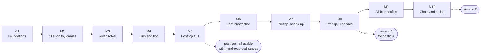

# Roadmap

This covers the brief's ten milestones in the brief's order, postflop first. The work is tracked as [GitHub issues](https://github.com/Ollienel777/poker-solver/issues) grouped into [milestones](https://github.com/Ollienel777/poker-solver/milestones).

## How the backlog works

- **Gates.** Each milestone ends with a `type: gate` issue that holds the brief's acceptance tests. Work in the next milestone is blocked by that gate, so the brief's rule that tests pass before moving on shows up in the tracker.
- **Decision issues** (`type: decision`) are never blocked by a gate, so answer them early. The M1 decisions, [#1](https://github.com/Ollienel777/poker-solver/issues/1) to [#5](https://github.com/Ollienel777/poker-solver/issues/5), were answered on 2026-11-23 and are recorded in [DECISIONS.md](DECISIONS.md).
- **Manual issues** (`type: manual`) are things you do by hand: recording reference ranges and setting up AWS billing. They can be done any time their inputs exist. Record references early, because the M5, M7 and M8 gates wait on them.
- **Blocked-by links** use GitHub's native issue dependencies and are repeated at the bottom of each issue body.
- **One branch and PR per milestone, with one commit per issue.** The PR body closes them with `Closes #N`.

## Where the order can bend

- **M6** needs only the evaluator (M1), the showdown sweep (M3) and suit isomorphism ([#35](https://github.com/Ollienel777/poker-solver/issues/35)). If postflop work stalls, it can run alongside M5 by moving its gate dependency.
- **The billing alarm** ([#69](https://github.com/Ollienel777/poker-solver/issues/69)) and the reference recordings ([#49](https://github.com/Ollienel777/poker-solver/issues/49), [#64](https://github.com/Ollienel777/poker-solver/issues/64), [#72](https://github.com/Ollienel777/poker-solver/issues/72)) have no gate, so they can be done whenever convenient.

## Effort

The brief's estimate for one person working steadily is M1 to M5 in 2 to 3 months and M6 to M10 in another 2 to 4 months.

## Milestones

### [M1 · Foundations](https://github.com/Ollienel777/poker-solver/milestone/1)

Cards, ranges, 7-card evaluator, equity, GameConfig with configs A-D. Gate: exhaustive evaluator counts + forced-bet and action-order tests.

| Issue | Title | Kind | Blocked by |
| --- | --- | --- | --- |
| [#1](https://github.com/Ollienel777/poker-solver/issues/1) | Decide: confirm Rust as the implementation language | decision | none |
| [#2](https://github.com/Ollienel777/poker-solver/issues/2) | Decide: table size (6-max or 8-9-handed) | decision | none |
| [#3](https://github.com/Ollienel777/poker-solver/issues/3) | Decide: ante format and size for configs C and D | decision | none |
| [#4](https://github.com/Ollienel777/poker-solver/issues/4) | Decide: straddle rules for configs C and D | decision | none |
| [#5](https://github.com/Ollienel777/poker-solver/issues/5) | Decide: rake model | decision | none |
| [#6](https://github.com/Ollienel777/poker-solver/issues/6) | Set up the Cargo workspace, toolchain pin and lint config | build | [#1](https://github.com/Ollienel777/poker-solver/issues/1) |
| [#7](https://github.com/Ollienel777/poker-solver/issues/7) | CI: GitHub Actions for fmt, clippy and fast tests | build | [#6](https://github.com/Ollienel777/poker-solver/issues/6) |
| [#8](https://github.com/Ollienel777/poker-solver/issues/8) | core: cards, card sets, combos and the 169 hand classes | build | [#6](https://github.com/Ollienel777/poker-solver/issues/6) |
| [#9](https://github.com/Ollienel777/poker-solver/issues/9) | core: Range type and range-string parser | build | [#8](https://github.com/Ollienel777/poker-solver/issues/8) |
| [#10](https://github.com/Ollienel777/poker-solver/issues/10) | core: 7-card hand evaluator | build | [#8](https://github.com/Ollienel777/poker-solver/issues/8) |
| [#11](https://github.com/Ollienel777/poker-solver/issues/11) | core: equity calculator (exact and Monte Carlo) | build | [#10](https://github.com/Ollienel777/poker-solver/issues/10), [#9](https://github.com/Ollienel777/poker-solver/issues/9) |
| [#12](https://github.com/Ollienel777/poker-solver/issues/12) | game: GameConfig schema and TOML loading, configs A-D | build | [#6](https://github.com/Ollienel777/poker-solver/issues/6), [#2](https://github.com/Ollienel777/poker-solver/issues/2), [#3](https://github.com/Ollienel777/poker-solver/issues/3), [#4](https://github.com/Ollienel777/poker-solver/issues/4), [#5](https://github.com/Ollienel777/poker-solver/issues/5) |
| [#13](https://github.com/Ollienel777/poker-solver/issues/13) | game: positions, forced bets and action order | build | [#12](https://github.com/Ollienel777/poker-solver/issues/12) |
| [#14](https://github.com/Ollienel777/poker-solver/issues/14) | M1 gate: evaluator category counts and forced-bet tests | gate | [#10](https://github.com/Ollienel777/poker-solver/issues/10), [#11](https://github.com/Ollienel777/poker-solver/issues/11), [#13](https://github.com/Ollienel777/poker-solver/issues/13), [#7](https://github.com/Ollienel777/poker-solver/issues/7) |

### [M2 · CFR on toy games](https://github.com/Ollienel777/poker-solver/milestone/2)

CFR, CFR+, DCFR, MCCFR and vector-form CFR with best response, on Kuhn and Leduc. Gate: Kuhn value -1/18, exploitability near zero.

| Issue | Title | Kind | Blocked by |
| --- | --- | --- | --- |
| [#15](https://github.com/Ollienel777/poker-solver/issues/15) | cfr: regret matching and discount schedules (CFR, CFR+, linear, DCFR) | build | [#14](https://github.com/Ollienel777/poker-solver/issues/14) |
| [#16](https://github.com/Ollienel777/poker-solver/issues/16) | cfr: game trait and tabular CFR for small games | build | [#15](https://github.com/Ollienel777/poker-solver/issues/15) |
| [#17](https://github.com/Ollienel777/poker-solver/issues/17) | cfr: Kuhn poker | build | [#16](https://github.com/Ollienel777/poker-solver/issues/16) |
| [#18](https://github.com/Ollienel777/poker-solver/issues/18) | cfr: exact best response and exploitability for two-player games | build | [#16](https://github.com/Ollienel777/poker-solver/issues/16) |
| [#19](https://github.com/Ollienel777/poker-solver/issues/19) | cfr: Leduc hold'em and convergence curves | build | [#18](https://github.com/Ollienel777/poker-solver/issues/18) |
| [#20](https://github.com/Ollienel777/poker-solver/issues/20) | cfr: external-sampling MCCFR | build | [#19](https://github.com/Ollienel777/poker-solver/issues/19) |
| [#21](https://github.com/Ollienel777/poker-solver/issues/21) | cfr: vector-form (public-tree) CFR, validated on Leduc | build | [#19](https://github.com/Ollienel777/poker-solver/issues/19) |
| [#22](https://github.com/Ollienel777/poker-solver/issues/22) | M2 gate: Kuhn value -1/18 and near-zero exploitability | gate | [#17](https://github.com/Ollienel777/poker-solver/issues/17), [#20](https://github.com/Ollienel777/poker-solver/issues/20), [#21](https://github.com/Ollienel777/poker-solver/issues/21) |

### [M3 · River solver](https://github.com/Ollienel777/poker-solver/milestone/3)

Heads-up range-vs-range river solver with vectorized showdown. Gate: exploitability < 0.3% pot on test spots, matches a reference solver.

| Issue | Title | Kind | Blocked by |
| --- | --- | --- | --- |
| [#23](https://github.com/Ollienel777/poker-solver/issues/23) | Decide: record the dev machine's cores, RAM and disk | decision | none |
| [#24](https://github.com/Ollienel777/poker-solver/issues/24) | Decide: pick and install the reference solver for cross-checks | decision | none |
| [#25](https://github.com/Ollienel777/poker-solver/issues/25) | game: postflop betting tree builder | build | [#22](https://github.com/Ollienel777/poker-solver/issues/22), [#13](https://github.com/Ollienel777/poker-solver/issues/13) |
| [#26](https://github.com/Ollienel777/poker-solver/issues/26) | postflop: vectorized showdown and fold evaluation with card removal | build | [#25](https://github.com/Ollienel777/poker-solver/issues/25) |
| [#27](https://github.com/Ollienel777/poker-solver/issues/27) | postflop: river spot setup and vector-form DCFR solve loop | build | [#26](https://github.com/Ollienel777/poker-solver/issues/26), [#21](https://github.com/Ollienel777/poker-solver/issues/21) |
| [#28](https://github.com/Ollienel777/poker-solver/issues/28) | postflop: rake at terminal nodes | build | [#26](https://github.com/Ollienel777/poker-solver/issues/26), [#5](https://github.com/Ollienel777/poker-solver/issues/5) |
| [#29](https://github.com/Ollienel777/poker-solver/issues/29) | postflop: exploitability (best response) for postflop trees | validation | [#27](https://github.com/Ollienel777/poker-solver/issues/27) |
| [#30](https://github.com/Ollienel777/poker-solver/issues/30) | validation: solution invariant checks | validation | [#27](https://github.com/Ollienel777/poker-solver/issues/27) |
| [#31](https://github.com/Ollienel777/poker-solver/issues/31) | core: range file format v1 (read and write) | build | [#22](https://github.com/Ollienel777/poker-solver/issues/22), [#9](https://github.com/Ollienel777/poker-solver/issues/9) |
| [#32](https://github.com/Ollienel777/poker-solver/issues/32) | validation: river test-spot set | validation | [#31](https://github.com/Ollienel777/poker-solver/issues/31) |
| [#33](https://github.com/Ollienel777/poker-solver/issues/33) | validation: cross-solver comparison harness | validation | [#24](https://github.com/Ollienel777/poker-solver/issues/24), [#32](https://github.com/Ollienel777/poker-solver/issues/32), [#27](https://github.com/Ollienel777/poker-solver/issues/27) |
| [#34](https://github.com/Ollienel777/poker-solver/issues/34) | M3 gate: river exploitability < 0.3% of pot and matches reference | gate | [#29](https://github.com/Ollienel777/poker-solver/issues/29), [#30](https://github.com/Ollienel777/poker-solver/issues/30), [#28](https://github.com/Ollienel777/poker-solver/issues/28), [#33](https://github.com/Ollienel777/poker-solver/issues/33) |

### [M4 · Turn and flop solver](https://github.com/Ollienel777/poker-solver/milestone/4)

Chance nodes, suit isomorphism, multithreading, compressed storage. Gate: local 100bb SRP flop solve matches reference; memory reported per tree.

| Issue | Title | Kind | Blocked by |
| --- | --- | --- | --- |
| [#35](https://github.com/Ollienel777/poker-solver/issues/35) | core: suit isomorphism for boards and dealt cards | build | [#34](https://github.com/Ollienel777/poker-solver/issues/34) |
| [#36](https://github.com/Ollienel777/poker-solver/issues/36) | postflop: turn and river chance nodes | build | [#34](https://github.com/Ollienel777/poker-solver/issues/34) |
| [#37](https://github.com/Ollienel777/poker-solver/issues/37) | perf: criterion benchmarks for postflop hot paths | perf | [#36](https://github.com/Ollienel777/poker-solver/issues/36) |
| [#38](https://github.com/Ollienel777/poker-solver/issues/38) | postflop: memory estimator and per-solve resource log | build | [#36](https://github.com/Ollienel777/poker-solver/issues/36) |
| [#39](https://github.com/Ollienel777/poker-solver/issues/39) | postflop: merge suit-isomorphic chance branches | perf | [#35](https://github.com/Ollienel777/poker-solver/issues/35), [#36](https://github.com/Ollienel777/poker-solver/issues/36), [#37](https://github.com/Ollienel777/poker-solver/issues/37) |
| [#40](https://github.com/Ollienel777/poker-solver/issues/40) | postflop: multithreading across chance branches | perf | [#37](https://github.com/Ollienel777/poker-solver/issues/37) |
| [#41](https://github.com/Ollienel777/poker-solver/issues/41) | postflop: 16-bit compressed regret and strategy storage | perf | [#37](https://github.com/Ollienel777/poker-solver/issues/37), [#38](https://github.com/Ollienel777/poker-solver/issues/38) |
| [#42](https://github.com/Ollienel777/poker-solver/issues/42) | validation: flop test-spot set (100bb SRP, reduced tree) | validation | [#34](https://github.com/Ollienel777/poker-solver/issues/34), [#23](https://github.com/Ollienel777/poker-solver/issues/23) |
| [#43](https://github.com/Ollienel777/poker-solver/issues/43) | M4 gate: local 100bb SRP flop solve matches reference; memory reported | gate | [#39](https://github.com/Ollienel777/poker-solver/issues/39), [#40](https://github.com/Ollienel777/poker-solver/issues/40), [#41](https://github.com/Ollienel777/poker-solver/issues/41), [#42](https://github.com/Ollienel777/poker-solver/issues/42) |

### [M5 · Postflop CLI](https://github.com/Ollienel777/poker-solver/milestone/5)

Solve from a range file + board, save/reload, 13x13 grids. Version 2's postflop half becomes usable with hand-recorded ranges.

Solutions are studied in a browser (DECISIONS D24): a local viewer, served by a `solver serve` command from the solution files M5 writes, is a milestone of its own straight after this gate, and its issues are written when it is planned. Whether it is also hosted is decided once it works. M5's `inspect` is the small terminal check that this gate's test reads.

| Issue | Title | Kind | Blocked by |
| --- | --- | --- | --- |
| [#44](https://github.com/Ollienel777/poker-solver/issues/44) | Decide: output format for studying | decision | none |
| [#45](https://github.com/Ollienel777/poker-solver/issues/45) | postflop: solution file format (save and load) | build | [#43](https://github.com/Ollienel777/poker-solver/issues/43) |
| [#46](https://github.com/Ollienel777/poker-solver/issues/46) | cli: solve-postflop | build | [#45](https://github.com/Ollienel777/poker-solver/issues/45) |
| [#47](https://github.com/Ollienel777/poker-solver/issues/47) | cli: inspect with 13x13 strategy grids | build | [#45](https://github.com/Ollienel777/poker-solver/issues/45) |
| [#48](https://github.com/Ollienel777/poker-solver/issues/48) | cli: compare two solutions, or a solution and a reference | validation | [#45](https://github.com/Ollienel777/poker-solver/issues/45) |
| [#49](https://github.com/Ollienel777/poker-solver/issues/49) | reference: hand-record config A preflop ranges for common formations | manual | [#31](https://github.com/Ollienel777/poker-solver/issues/31) |
| [#50](https://github.com/Ollienel777/poker-solver/issues/50) | M5 gate: postflop half usable from a range file | gate | [#46](https://github.com/Ollienel777/poker-solver/issues/46), [#47](https://github.com/Ollienel777/poker-solver/issues/47), [#48](https://github.com/Ollienel777/poker-solver/issues/48), [#49](https://github.com/Ollienel777/poker-solver/issues/49) |

### [M6 · Card abstraction](https://github.com/Ollienel777/poker-solver/milestone/6)

Equity-histogram bucketing for flop, turn, river, cached to disk. Gate: deterministic, sensible on spot checks.

| Issue | Title | Kind | Blocked by |
| --- | --- | --- | --- |
| [#51](https://github.com/Ollienel777/poker-solver/issues/51) | core: hand isomorphism indexer for all streets | build | [#50](https://github.com/Ollienel777/poker-solver/issues/50) |
| [#52](https://github.com/Ollienel777/poker-solver/issues/52) | abstraction: river equity table | build | [#51](https://github.com/Ollienel777/poker-solver/issues/51) |
| [#53](https://github.com/Ollienel777/poker-solver/issues/53) | abstraction: equity histograms for flop and turn | build | [#52](https://github.com/Ollienel777/poker-solver/issues/52) |
| [#54](https://github.com/Ollienel777/poker-solver/issues/54) | abstraction: k-means with 1-D earth mover's distance | build | [#53](https://github.com/Ollienel777/poker-solver/issues/53) |
| [#55](https://github.com/Ollienel777/poker-solver/issues/55) | abstraction: bucket tables cached to disk | build | [#54](https://github.com/Ollienel777/poker-solver/issues/54) |
| [#56](https://github.com/Ollienel777/poker-solver/issues/56) | M6 gate: deterministic bucketing and spot checks | gate | [#55](https://github.com/Ollienel777/poker-solver/issues/55) |

### [M7 · Preflop solver, heads-up](https://github.com/Ollienel777/poker-solver/milestone/7)

MCCFR over the abstracted full game, two players. Gate: plausible BTN open / BB defend; checkpoints resume after a kill.

| Issue | Title | Kind | Blocked by |
| --- | --- | --- | --- |
| [#57](https://github.com/Ollienel777/poker-solver/issues/57) | Decide: allow limps in the preflop tree | decision | none |
| [#58](https://github.com/Ollienel777/poker-solver/issues/58) | Decide: how 3+-way pots are played inside the preflop solve | decision | none |
| [#59](https://github.com/Ollienel777/poker-solver/issues/59) | game: preflop tree builder | build | [#56](https://github.com/Ollienel777/poker-solver/issues/56), [#57](https://github.com/Ollienel777/poker-solver/issues/57) |
| [#60](https://github.com/Ollienel777/poker-solver/issues/60) | preflop: abstracted full game and information-set layout | build | [#59](https://github.com/Ollienel777/poker-solver/issues/59), [#58](https://github.com/Ollienel777/poker-solver/issues/58) |
| [#84](https://github.com/Ollienel777/poker-solver/issues/84) | preflop: carry the M2 review notes on MCCFR at scale into the design | build | [#20](https://github.com/Ollienel777/poker-solver/issues/20) |
| [#61](https://github.com/Ollienel777/poker-solver/issues/61) | preflop: external-sampling MCCFR solve loop | build | [#60](https://github.com/Ollienel777/poker-solver/issues/60) |
| [#62](https://github.com/Ollienel777/poker-solver/issues/62) | preflop: checkpoint and resume | build | [#61](https://github.com/Ollienel777/poker-solver/issues/61) |
| [#63](https://github.com/Ollienel777/poker-solver/issues/63) | preflop: strategy export and convergence diagnostics | build | [#61](https://github.com/Ollienel777/poker-solver/issues/61) |
| [#64](https://github.com/Ollienel777/poker-solver/issues/64) | reference: hand-record a heads-up 100bb preflop chart | manual | [#31](https://github.com/Ollienel777/poker-solver/issues/31) |
| [#65](https://github.com/Ollienel777/poker-solver/issues/65) | M7 gate: plausible heads-up ranges and resume after kill | gate | [#62](https://github.com/Ollienel777/poker-solver/issues/62), [#63](https://github.com/Ollienel777/poker-solver/issues/63), [#64](https://github.com/Ollienel777/poker-solver/issues/64) |

### [M8 · Preflop solver, 8-handed](https://github.com/Ollienel777/poker-solver/milestone/8)

N players, config A locally then full scale on AWS. Gate: opening ranges within a few points of reference. Completes version 1 for config A.

| Issue | Title | Kind | Blocked by |
| --- | --- | --- | --- |
| [#66](https://github.com/Ollienel777/poker-solver/issues/66) | preflop: N-player games | build | [#65](https://github.com/Ollienel777/poker-solver/issues/65) |
| [#67](https://github.com/Ollienel777/poker-solver/issues/67) | preflop: formation extraction and export-ranges | build | [#66](https://github.com/Ollienel777/poker-solver/issues/66) |
| [#68](https://github.com/Ollienel777/poker-solver/issues/68) | Run config A locally at low iteration counts | build | [#66](https://github.com/Ollienel777/poker-solver/issues/66), [#23](https://github.com/Ollienel777/poker-solver/issues/23) |
| [#69](https://github.com/Ollienel777/poker-solver/issues/69) | aws: billing alarm and budget before the first instance | manual | none |
| [#70](https://github.com/Ollienel777/poker-solver/issues/70) | aws: run script with auto-shutdown, spot support and S3 checkpoints | build | [#65](https://github.com/Ollienel777/poker-solver/issues/65), [#69](https://github.com/Ollienel777/poker-solver/issues/69) |
| [#71](https://github.com/Ollienel777/poker-solver/issues/71) | Full-scale config A preflop solve on AWS | build | [#68](https://github.com/Ollienel777/poker-solver/issues/68), [#70](https://github.com/Ollienel777/poker-solver/issues/70) |
| [#72](https://github.com/Ollienel777/poker-solver/issues/72) | reference: hand-record 8-handed opening ranges for config A | manual | [#31](https://github.com/Ollienel777/poker-solver/issues/31) |
| [#73](https://github.com/Ollienel777/poker-solver/issues/73) | M8 gate: config A opening ranges within a few points of reference | gate | [#71](https://github.com/Ollienel777/poker-solver/issues/71), [#67](https://github.com/Ollienel777/poker-solver/issues/67), [#72](https://github.com/Ollienel777/poker-solver/issues/72) |

### [M9 · All four configs](https://github.com/Ollienel777/poker-solver/milestone/9)

Solve configs B, C, D and export every heads-up formation.

| Issue | Title | Kind | Blocked by |
| --- | --- | --- | --- |
| [#74](https://github.com/Ollienel777/poker-solver/issues/74) | Full preflop solves for configs B, C and D | build | [#73](https://github.com/Ollienel777/poker-solver/issues/73) |
| [#75](https://github.com/Ollienel777/poker-solver/issues/75) | Export ranges for every heads-up formation, all configs | build | [#74](https://github.com/Ollienel777/poker-solver/issues/74) |
| [#76](https://github.com/Ollienel777/poker-solver/issues/76) | validation: straddle and ante sanity checks | validation | [#74](https://github.com/Ollienel777/poker-solver/issues/74) |
| [#77](https://github.com/Ollienel777/poker-solver/issues/77) | M9 gate: all four configs solved and exported | gate | [#75](https://github.com/Ollienel777/poker-solver/issues/75), [#76](https://github.com/Ollienel777/poker-solver/issues/76) |

### [M10 · Chain and polish](https://github.com/Ollienel777/poker-solver/milestone/10)

Preflop export feeds the postflop solver end to end. Completes version 2.

| Issue | Title | Kind | Blocked by |
| --- | --- | --- | --- |
| [#78](https://github.com/Ollienel777/poker-solver/issues/78) | End-to-end: preflop export feeds the postflop solver | build | [#77](https://github.com/Ollienel777/poker-solver/issues/77) |
| [#79](https://github.com/Ollienel777/poker-solver/issues/79) | docs: usage guide and AWS runbook | build | [#78](https://github.com/Ollienel777/poker-solver/issues/78) |
| [#80](https://github.com/Ollienel777/poker-solver/issues/80) | M10 gate: version 2 complete | gate | [#78](https://github.com/Ollienel777/poker-solver/issues/78), [#79](https://github.com/Ollienel777/poker-solver/issues/79) |

## Risks

| Risk | Why it matters | Mitigation | Issues |
| --- | --- | --- | --- |
| A solver converges and is still wrong | Wrong strategies look plausible | Exploitability before any perf work, invariants, brute-force oracles, and toy games with known answers (Kuhn, polarized river) | [#29](https://github.com/Ollienel777/poker-solver/issues/29), [#30](https://github.com/Ollienel777/poker-solver/issues/30) |
| Preflop memory exceeds an affordable instance | 8-handed tree × buckets × actions | Estimate before allocating, average strategy only at preflop nodes, compact regrets, fewer buckets | [#60](https://github.com/Ollienel777/poker-solver/issues/60), [#68](https://github.com/Ollienel777/poker-solver/issues/68) |
| 3+-way pots distort preflop ranges | The abstract game has to play them somehow | An explicit decision, then measurement in M8 | [#58](https://github.com/Ollienel777/poker-solver/issues/58) |
| No ground truth for a multiway solve | CFR has no guarantee with 3+ players | Seed-to-seed stability, convergence diagnostics, reference ranges | [#63](https://github.com/Ollienel777/poker-solver/issues/63), [#72](https://github.com/Ollienel777/poker-solver/issues/72) |
| The reference source lacks our configs | 200bb, straddle and ante may not be covered | Confirm before paying for a commercial solver month | [#72](https://github.com/Ollienel777/poker-solver/issues/72) |
| The dev machine is too small for the M4 flop solve | Blocks the M4 gate locally | Reduced tree, memory estimate first, specs recorded | [#23](https://github.com/Ollienel777/poker-solver/issues/23), [#38](https://github.com/Ollienel777/poker-solver/issues/38) |
| Preflop cost at 8-handed exceeds the credits | The brief's estimates assumed 6-max, and it puts 8 players at 3 to 5 times the preflop cost | Spot instances for every full run, low-iteration local runs first, a memory estimate before launch, and fewer buckets or a smaller multiway tree if needed | [#58](https://github.com/Ollienel777/poker-solver/issues/58), [#68](https://github.com/Ollienel777/poker-solver/issues/68), [#70](https://github.com/Ollienel777/poker-solver/issues/70) |
| AWS cost overrun | A forgotten $4/hour instance costs about $3,000 a month | Billing alarm first, auto-shutdown on completion and idle, both tested | [#69](https://github.com/Ollienel777/poker-solver/issues/69), [#70](https://github.com/Ollienel777/poker-solver/issues/70) |
| AGPL contamination | Licence | Reference solvers only as external binaries, algorithms implemented from papers | [#24](https://github.com/Ollienel777/poker-solver/issues/24) |
